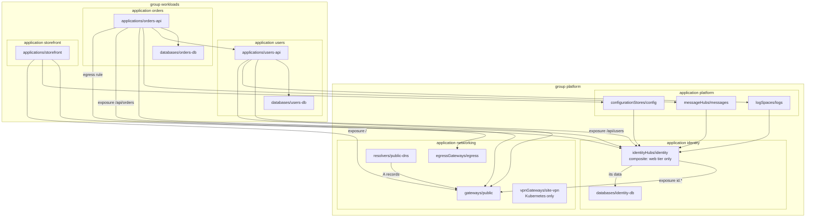

# BookStore on Application Model v2

> **Nothing here runs.** This folder shows how BookStore would be written once the Application Model v2 design ("the
> ResourceManager, fabric, and composite resources") is implemented. No Cohesion build carries that surface, and the
> SDK versions in `global.json` do not exist. One part was held to a compiler: the code of the six AppHosts equals six
> programs that compile against a stub library kept beside the v2 design (`apphost-surface/`, with `SURFACE.md` as its
> reference). The stubs record declarations and print them. No ResourceManager, document or driver is behind them, and
> no other file in this folder was compiled at all. Section numbers such as "v2 §8.6" refer to the design.
>
> **`[proposed]` marks what this example adds to v2** to make BookStore work end to end. Each AppHost names in its
> header what is `[proposed]` in that file. The additions are listed, ranked, in
> [What the example had to invent](#what-the-example-had-to-invent). Read that section before treating any of this as
> settled. A mark that reads "[proposed] in v2" is different. That proposal is the design's own, and it waits for the
> owner's word. Most of them follow from the deploy rule the owner decided on 2026-11-19 (v2 §6.1).
>
> **The owner's word on roles came on 2026-11-20 and 2026-11-21** (v2 §15). Decisions 29, 35 and 38 are decided: the
> Operator role, the hold with `pause` and `resume`, and what a PATCH may change. So is the roles design, decisions
> 40 to 44: permissions narrower than `write`, the predefined roles, a role an AppHost defines, and who may hand out a
> right. This README states all of it as decided. Of the roles design only the fine print and the names are still
> "[proposed] in v2" (decision 45). Examples of the names: `AddRoleDefinition`, `Permissions.<Area>`,
> `OperableSettings`, `--escalate`, the error codes, and the role names Incident Responder and
> `{Namespace} Administrator`. What the names do is decided.
>
> **On 2026-11-22 the owner decided one part of decision 36** (v2 §15): whoever changes a resource through the API is
> not told that a later deploy undoes the change, nothing lists such a change, and a pipeline gets no gate for one.
> What `what-if` prints is still "[proposed] in v2".
>
> **On the same day the owner decided where an IdentityHub keeps its data** (v2 §15, decision 46): a hub with no
> database declared gets a private one, and declaring a database replaces it. BookStore declares one, `identity-db`,
> with a project of its own. That BookStore takes the declared form and not the default is the designer's choice for
> this example, so that it shows the owner's sketch of that day as the design reads it: a hub, a database project
> that the developer writes, and an AppHost. It is not the owner's decision, and it is "[proposed] in v2" (§1). That
> the developer writes the database project is the owner's decision, made later that day. So is that this form ships
> in the first version without a restore through the ResourceManager, and so is that a deployed hub cannot switch
> between the two forms (v2 §1 and §15, above row 46). On 2026-11-23 the owner decided one spelling of it as well:
> the one line of the database's program passes no database name, and the hub's package supplies it (v2 §1). Every
> name and every other spelling of the declared form, and every other rule of it, is "[proposed] in v2". Where a
> private database's durability, memory, size and disk are written the owner decided on the evening of 2026-11-22:
> in the hub's `Store` block in the AppHost (v2 §15, row 8). Who builds a private database's program the owner
> decided on 2026-11-23: the SDK, when the hub is published. Which host that program is built on the owner decided
> the same day: a small host of IdentityHub's own (v2 §15, row 9). For a resource that reads another resource of its
> application the owner decided the order that day too: the ResourceManager creates or updates a resource once what
> it reads is Ready, so `identity-db` comes before the hub (v2 §15, decision 47). A declaration that only names a
> program, such as `orders-api-ingress`, waits for that program: the owner answered that on 2026-11-24, "Yes it
> should wait" (v2 §1 and §6.2). [Where identity keeps its data](#where-identity-keeps-its-data) says what
> BookStore's choice of the declared form costs.
>
> **The AppHost surface is "sections", chosen by the owner on 2026-11-18:** `app.<Provider>.Add…("name", new() { …
> })`. On 2026-11-24 the owner named `Assimalign.Cohesion.Fabric.Providers` as the root namespace of the provider
> packages and decided, in two steps, on two overloads: the object, `new() { … }`, and a callback, `options => { …
> }`, with the project of a program as a type argument, `app.Web.Add<Projects.BookStore_Users_Api>("users-api", …)`.
> The owner's sketch has the type argument on the callback overload only. That the object overload takes it too, and
> that every verb that declares has both overloads, is this example's reading and [proposed]. Five of the six
> AppHosts and most of the code in this file are written in the object overload. The users AppHost is written in the
> callback overload, since the owner asked that day for one zone that shows it. Both declare the same resources, and
> [Reading an AppHost](#reading-an-apphost) shows the users application in both. Sections is the third surface this
> example has had, and the two overloads are its second spelling of that day. A panel compiled four shapes and its
> chair recommended another one, Bicep-like declarations; the owner chose the runner-up. [Reading an
> AppHost](#reading-an-apphost) is the surface, and [What sections costs](#what-sections-costs) is its price: items
> 1, 2, 5, 14 and 15 there are what the two overloads changed.

The gateway scaffold this replaces (design scaffold of 2026-11-03: a tenant gateway, three zone gateways, `AddResource`
in every program, operations between gateways) is deleted, not kept beside it.

## The shape

One **ResourceManager** per environment holds the state and does the reconciling. Each team ships an **AppHost** that
emits one typed document for one **application** and PUTs it. The programs themselves are plain: none of them knows
where it runs.



Every arrow is a `$ref` from a consumer to the resource it reads. An arrow that crosses an application boundary needs
`bind` on its target, which the target's own AppHost grants by name with `AllowBind`. Some edges to `logs` are left
out to keep the picture readable, and so are three Kubernetes-only resources: the `public-tls` manifest, the
disruption budget of `users-api` and the network policy of `orders-api`. The arrow from the hub to `identity-db` is
the hub's `Store` block naming the database it keeps its data in
([Where identity keeps its data](#where-identity-keeps-its-data)).

A node's label is the end of its resource id. `applications/users-api` is `Cohesion.Web/applications/users-api`, a
web application inside the application `users`. That type id is [proposed], and it puts the word "applications" in
one id twice.

## Reading an AppHost

**An AppHost no longer shows most of what its workloads are.** Ports, node pools, CPU, memory, storage classes and the
number of instances on a developer's machine are decided by the resource type, the environment or the platform, and
none of them is in the file. That is what was asked for: a workload predefined for each resource, with an escape hatch
for the developer who wants more control. It is also the price, and
[What an AppHost does not show](#what-an-apphost-does-not-show-and-how-to-see-it) says where each answer went.

Five rules read every file. They are written here once: each AppHost's header points at this README and repeats
none of them. The lines under each rule are lines of BookStore's AppHosts.

1. **A file reads top to bottom in one order: the application and its target platforms, what the environment
   supplies, what other applications own, the roles this application defines, what it declares, access to the whole
   application, and `RunAsync` last.**

   ```csharp
   var app = CohesionApplication.CreateBuilder("orders", Platforms.InProcess, Platforms.Kubernetes);
   return await app.RunAsync(args);
   ```

2. **Every statement starts at its owner: `app.<Section>.Add…("name", new() { … })` declares a resource of that
   section's area in this application, with the project of a program in angle brackets after the verb, and
   `otherApp.<Section>.Get…("name")` refers to one that another application owns.**

   ```csharp
   var ordersDb = app.Database.Add<Projects.BookStore_Orders_Database>("orders-db", new()
   var publicGateway = networkingApp.Networking.GetGateway("public");
   ```

3. **A declaration applies on every target platform unless a platform's name is written: `app.Kubernetes.Add<Type>`
   declares one of Kubernetes' own types, `app.Kubernetes.<Section>.Add` declares a portable type on Kubernetes
   only, and `Kubernetes = new() { … }` among a declaration's members is a block only the Kubernetes driver reads.**

   ```csharp
   app.Kubernetes.AddNetworkPolicy("orders-api-ingress", new()
   app.Kubernetes.VpnGateway.Add<Projects.BookStore_Networking_VpnGateway>("site-vpn", new()
   Kubernetes = new() { StaticAddress = dnsAddress },
   ```

4. **What a declaration does not say, its type or the environment decided, and the one block that overrides them is
   named `WorkloadHatch`.**

   ```csharp
   Scale = Scale.Between(3, 10),
   WorkloadHatch = new()
   ```

5. **The one brace rule: after `=` you write a value, `new() { … }` for a map or a block, or `[ … ]` for a list, and
   a bare `{` after `=` never compiles.**

   ```csharp
   Settings = new() { ["Federation:Upstream:Authority"] = corporateAuthority },
   AllowBind = ["platform", "users", "orders", "storefront"],
   ```

The questions the first version of this example could not answer at a glance: what comes first is rule 1; which area a
declaration belongs to is rule 2, the word after `app.`; which platform it applies to is rule 3, and nowhere else.

Three limits of the rules. Of rule 1 the compiler enforces only that a line can read what is declared above it
(CS0841); the rest is a convention the six files follow. That one check is why the role the orders AppHost defines
stands above the declaration that assigns it. In rule 2 there are two shapes of verb: a section with one type has
the verb `Add` (`app.Web.Add`), and a section with several types names the type in the verb
(`app.Networking.AddExposure`). `app.Authorization` names the type too: `AddRoleDefinition`, `AddRoleAssignment`.
And since 2026-11-24 every verb that declares has a second overload, which takes a callback where the object stands.
One of the six files uses it, the users AppHost, which is shown below in both. A callback is code: nothing stops one
that decides with an `if` what it declares, and a member it writes twice is found when the AppHost runs and not when
it compiles ([What sections costs](#what-sections-costs), item 14).

These three lines are the callback overload, from `spellings/Program.cs` in `apphost-surface/`, which compiles
against the same stubs. What the type requires stands before the callback as an argument of the verb: the project in
angle brackets, an exposure's target, a volume's size. The callback can be left out where there is nothing more to
say. Those argument lists are [proposed].

```csharp
var reportsScratch = app.Database.Add<Projects.BookStore_Reports_Database>("reports-scratch");
app.Networking.AddExposure("reports-worker", reportsWorker);
var scratch = app.Storage.AddVolume("scratch", "10Gi", options => options.Reclaim = VolumeReclaim.Delete);
```

### One whole AppHost

The users application, whole, in the object overload, as it compiles against the stubs (`users-object/` in
`apphost-surface/`). It is the common case: a database, a web application, an exposure on a gateway another application
owns, and one Kubernetes-only resource. `Zones/Users/BookStore.Users.AppHost/src/Program.cs` declares the same in the
callback overload, shown after it.

```csharp
// The users application: users-db and users-api, on the public gateway under /api/users.

using Assimalign.Cohesion.Fabric.Providers;

var app = CohesionApplication.CreateBuilder("users", Platforms.InProcess, Platforms.Kubernetes);

var publicHost = app.Environment.Parameter("publicHost");

var identityApp = app.Environment.Application("identity", localStandIn: Projects.BookStore_Identity_AppHost);
var platformApp = app.Environment.Application("platform", localStandIn: Projects.BookStore_Platform_AppHost);
var networkingApp = app.Environment.Application("networking", localStandIn: Projects.BookStore_Networking_AppHost);

var identity = identityApp.IdentityHub.Get("identity");
var logs = platformApp.LogSpace.Get("logs");
var publicGateway = networkingApp.Networking.GetGateway("public");

var usersDb = app.Database.Add<Projects.BookStore_Users_Database>("users-db", new()
{
    Storage = "10Gi",
    BackupBeforeUpgrade = BackupPolicy.Required,
    Lock = ResourceLock.CannotDelete,
    RoleAssignments = [new(Roles.Database.Operator, Principal.Group("users-dba"))],
});

var usersApi = app.Web.Add<Projects.BookStore_Users_Api>("users-api", new()
{
    Scale = 2,
    Settings = new()
    {
        ["ConnectionStrings:Users"] = usersDb.ConnectionSecret,
        ["Authentication:Authority"] = identity.Issuer,
        ["Telemetry:Endpoint"] = logs.Url,
    },
    // orders-api calls users-api.
    AllowBind = ["orders"],
});

app.Networking.AddExposure("users-public", new()
{
    Target = usersApi,
    Gateway = publicGateway,
    Host = publicHost,
    Path = "/api/users",
    StripPrefix = true,
});

app.Kubernetes.AddPodDisruptionBudget("users-api", new() { AppliesTo = usersApi, MinAvailable = 1 });

app.Authorization.AddRoleAssignment(Roles.Operator, Principal.Group("users-oncall"));

return await app.RunAsync(args);
```

**The same four declarations in the callback overload,** which is how
`Zones/Users/BookStore.Users.AppHost/src/Program.cs` is written. The owner asked on 2026-11-24 for one zone that shows
it. Every other line of the file is the same, and the file prints the same run.

```csharp
var usersDb = app.Database.Add<Projects.BookStore_Users_Database>("users-db", options =>
{
    options.Storage = "10Gi";
    options.BackupBeforeUpgrade = BackupPolicy.Required;
    options.Lock = ResourceLock.CannotDelete;
    options.RoleAssignments = [new(Roles.Database.Operator, Principal.Group("users-dba"))];
});

var usersApi = app.Web.Add<Projects.BookStore_Users_Api>("users-api", options =>
{
    options.Scale = 2;
    options.Settings = new()
    {
        ["ConnectionStrings:Users"] = usersDb.ConnectionSecret,
        ["Authentication:Authority"] = identity.Issuer,
        ["Telemetry:Endpoint"] = logs.Url,
    };
    // orders-api calls users-api.
    options.AllowBind = ["orders"];
});

app.Networking.AddExposure("users-public", usersApi, options =>
{
    options.Gateway = publicGateway;
    options.Host = publicHost;
    options.Path = "/api/users";
    options.StripPrefix = true;
});

app.Kubernetes.AddPodDisruptionBudget("users-api", usersApi, options => options.MinAvailable = 1);
```

What differs. Each member is an assignment that ends with `;`, on `options`. What a type requires is not a member any
more: the exposure's target and the budget's `AppliesTo` stand before the callback as arguments of the verb, which is
[proposed]. A map inside the callback keeps `new() { … }`. The file is 37 code lines and 1806 characters in this
overload, against 38 and 1719 in the object overload. Nothing here uses what a callback allows and an object does not,
a statement between two assignments. [What sections costs](#what-sections-costs), item 14, says what the compiler
checks in each.

What to notice, and what is missing on purpose:

- **The order is rule 1.** The application and its two platforms; the one parameter the environment supplies; three
  applications other teams own, each with the AppHost that stands in for it locally, and one resource read from each;
  four declarations; access to the whole application; `RunAsync`.
- **`users-db` has no port, no volume, no mount path, no node pool, no storage class and no CPU or memory.** The
  `Database` type predefines the first three. The environment's `stateful` class and `medium` size supply the rest.
  `Storage = "10Gi"` equals the type's default and is written anyway: a disk size is data, and a later change of a
  default must not resize a database.
- **`Scale = 2` means two instances on Kubernetes and one on a developer's machine.** No line says the second half.
  It is a rule of the in-process platform, and only the printed run states it.
- **`AllowBind = ["orders"]` is the other half of a line in another file.** The orders AppHost writes
  `usersApp.Web.Get("users-api")`, and admission refuses its document unless this grant exists. Nothing on the `Get`
  line shows that.
- **The exposure names no port.** It takes the port `WebApplication` marks as exposable, `http`.
- **`var x =` is written only when a later line reads `x`.** `Add` returns the resource, and a resource has outputs
  (`usersDb.ConnectionSecret`) and nothing to set. A declaration is complete when its verb returns. A line that
  writes afterwards to an object the file kept in a variable compiles, and is refused when the AppHost runs ([What
  sections costs](#what-sections-costs), item 14).
- **Two lines of `users-db` say less than they do.** `BackupBeforeUpgrade = BackupPolicy.Required` makes the
  outgoing version back up before every upgrade, and left out it is `BackupPolicy.None`.
  `Lock = ResourceLock.CannotDelete` holds until an Owner removes the lock (v2 §10.6). What a deploy does then is
  decided (v2 §15, decision 35, on 2026-11-21): the next deploy puts the lock back, because the document declares
  it, and a deploy leaves alone a lock an Owner added through the API to a resource whose declaration has none.
- **`Roles.Operator` is decided** (v2 §15, decision 29, on 2026-11-21). It is a predefined role, v2's word since that
  day for what it called a built-in role, here at application scope. On every resource of the application it reads,
  invokes the actions the resource's provider marks for the role (restart, scale within the declared range, read
  logs) and changes the settings that are marked operable (decision 41). It holds no `write` and no Sensitive
  action, and what it reaches differs by provider, so its name does not say what it grants. On `users-api` the
  `scale` action is refused (decision 38). `Scale = 2` is a fixed count, so the declared range is that one number,
  the action has nothing to choose, and its message says so. Changing a fixed count takes `write`, which this role
  does not hold, or a change of this file. With a range, such as `Scale.Between(3, 10)` on `orders-api`, the action
  raises or lowers the range's minimum inside the range of the last deployed document, and the autoscaler keeps
  working above it. That is a change of spec made for its caller, so it is an override, and the next deploy undoes
  it.
- **`Roles.Database.Operator` is the Database provider's own Operator,** given here on `users-db` alone. It reads
  the database and invokes the actions that provider marks for it. It does not hold the right to grow the volume,
  because that costs money and cannot be undone (decision 42), so `users-dba` cannot grow `users-db`.

**The orders AppHost adds two things this file does not need: a role of its own, and settings that on-call may
change** (v2 §10.6 and §15, decisions 40, 41 and 43). From `Zones/Orders/BookStore.Orders.AppHost/src/Program.cs`:
the role, the line of `orders-db` that assigns it, and two lines of `orders-api`.

```csharp
var ordersDbKeeper = app.Authorization.AddRoleDefinition("orders-db-keeper", new()
{
    Description = "Operate orders-db and grow its volume.",
    BasedOn = Roles.Database.Operator,
    Permissions = [Permissions.Database.StorageWrite],
});
    RoleAssignments = [new(ordersDbKeeper, Principal.Group("orders-dba"))],
        ["Checkout:MaxLines"] = "50",
    OperableSettings = ["Checkout:*"],
```

- **The role** is the Database provider's Operator plus one permission, the `storage` part of a database, so
  `orders-dba` can grow `orders-db` where `users-dba` cannot grow `users-db`. Nobody redefines a predefined role, a
  role only adds to its base, and only the orders document can assign this one: a UI hands out predefined roles
  only. **What it costs:** six lines, and a reach the file does not show. The base is what the running
  ResourceManager says it is, and it changes at an upgrade without the orders team acting. A deploy that adds or
  changes the role is refused with `RoleEscalation` unless its sender holds everything the role holds, or is an
  Owner of the environment who sends `--escalate`. The orders pipeline holds all of it: as Application Deployer it
  may define a role in its own application, its `write` on the database covers the part, and the role names no
  Sensitive action.
- **`OperableSettings`** lists the keys of `orders-api` that a holder of `settings/write` may change through the API
  without `write`. `Roles.Operator` holds that permission, so `orders-oncall` may change `Checkout:MaxLines` at
  night. The six other settings stay closed: each is a reference, which is wiring and takes `write`. **What it
  costs:** a deploy of orders that changes the list changes what every holder of Operator may write on `orders-api`,
  people whom a UI or the access file gave the role included. By listing a section the orders team vouches for every
  key in it ([proposed] in v2, decision 45). The change itself is an override, so the next deploy puts the key back
  to 50.
- **Nothing behind either is built.** The stubs check the spellings and print them, and the Database provider has no
  `storage` part yet. The names are [proposed] in v2 (decision 45), and what they do is decided.

### Physical, fabric and virtual

Three words describe a resource type, and all three are the owner's. A **physical** type is one Cohesion runs a
program for. A **fabric resource** is portable and runs no program of Cohesion's: it has an id, a lifecycle, access
rules and outputs like any other resource, and every platform does the work its own way. A **virtual** resource is a
platform's own object, declared through that platform's section. A declaration that names a project runs a program,
so it is physical. In BookStore's six files that is the whole test: every declaration whose verb names a project in
angle brackets is physical, and of the others one written through `app.Networking` is a fabric resource and one
written through `app.Kubernetes` is virtual. BookStore's 22 resources:

| Kind | BookStore's resources |
| --- | --- |
| **physical** | `users-db`, `orders-db`, `identity-db` (`app.Database`); `users-api`, `orders-api`, `storefront` (`app.Web`); `identity` (`app.IdentityHub`); `logs` (`app.LogSpace`); `config` (`app.ConfigurationStore`); `messages` (`app.MessageHub`); `public-dns` (`app.Rezolvr`); and `site-vpn`, a `VpnGateway` declared through `app.Kubernetes.VpnGateway.Add` because it needs the host's network, so it exists on Kubernetes only |
| **fabric** | the exposures `users-public`, `orders-public`, `storefront-public` and `dns`; the gateway `public`; the egress gateway `egress`; the egress rule `payments` (all `app.Networking`) |
| **virtual** | the manifest `public-tls`, the disruption budget `users-api`, the network policy `orders-api-ingress` (all `app.Kubernetes`) |

**The words changed twice, and no AppHost changed with them.** The owner introduced "physical" and "virtual" on
2026-11-18 with one example, a Kubernetes NetworkPolicy. Until 2026-11-24 this example called every type without a
program virtual, an exposure included. The owner answered on 2026-11-19 that a virtual resource is a platform's own
object, declared through that platform's section (v2 §15, decision 17), and on 2026-11-24 that the portable types
that run no program are fabric resources. The words appear in no AppHost, so none of the six files changed. What
changed is this section and the kind that a printed run shows.

### What each type predefines

A physical type decides what follows from what the resource is. An AppHost cannot change a cell of this table except
through the members its declaration has (`Scale`, `Size`, `Storage`) or through the hatch.

| Type | BookStore's resources | Class | Ports | Stateful: mount path, reclaim | Instances | Default size | Default storage | Needs from a platform |
| --- | --- | --- | --- | --- | --- | --- | --- | --- |
| `WebApplication` | `users-api`, `orders-api`, `storefront` | stateless | `http` 8080 | no | 1; has `Scale` | small | none | nothing |
| `Database` | `users-db`, `orders-db`, `identity-db` | stateful | `sql` 5432 | yes: `/var/lib/database`, Retain | 1, fixed | medium | 10Gi | nothing |
| `LogSpace` | `logs` | stateful | `otlp` 4318 | yes: `/var/lib/logspace`, Retain | 1, fixed | medium | 10Gi | nothing |
| `ConfigurationStore` | `config` | stateful | `http` 8080 | yes: `/var/lib/configurationstore`, Retain | 1, fixed | small | 1Gi | nothing |
| `MessageHub` | `messages` | stateful | `amqp` 5672 | yes: `/var/lib/messagehub`, Retain | 1, fixed | medium | 10Gi | nothing |
| `Rezolvr` | `public-dns` | edge | `dns-udp` 53/UDP, `dns-tcp` 53/TCP | no | 1; has `Scale` | small | none | nothing |
| `VpnGateway` | `site-vpn` | edge | `ike` 500/UDP, `nat-t` 4500/UDP; no exposure can take either | no | 1; no `Scale`, its hatch has `Instances` | small | none | the host's network and `NET_ADMIN` |
| `IdentityHub`, web tier | `identity` | stateless | `http` 8080, exposed through the tier's own `Exposure` | no | 1; `Scale` inside `Web` | small | none | nothing |
| `IdentityHub`, store tier | none: `identity` names `identity-db`, so it has no store tier | stateful | `sql` 5432, private | yes: `/var/lib/database`, Retain | 1, fixed | medium | 10Gi | nothing |

- **Class** is `stateless`, `stateful` or `edge`. The environment maps it to placement (next section).
- **Ports.** An exposure with no `Ports` takes the ports its target's type marks as exposable: `http` for a web
  application, both ports for `Rezolvr`. No exposure in BookStore names a port.
- **Stateful** means one writer per volume: one instance, replaced and never rolled during an update, and a volume
  that is kept when the resource is deleted. The three volumes the platform AppHost used to declare are gone from the
  file: `LogSpace`, `ConfigurationStore` and `MessageHub` own theirs.
- **Every type also predefines** a readiness probe on its first port and its update strategy. The stubs state that in
  comments only.

Eight types, and six of them belong to provider packages that do not exist: Web, LogSpace, ConfigurationStore,
MessageHub, Rezolvr and VpnGateway. Their type ids (`Cohesion.Web/applications`, `Cohesion.LogSpace/logSpaces`, and
so on) are [proposed]. Only `Cohesion.Database/databases` and `Cohesion.IdentityHub/identityHubs` are v2's.

### Where identity keeps its data

**A hub that declares nothing gets a private database.** The owner decided that on 2026-11-22, with the answer
"Both, hidden by default" (v2 §15, decision 46): "A hub with no database declared gets a private one built from your
package. Declaring a database replaces it. Upgrade, backup and restore are tested on two paths." The private
database is the hub's store tier, the last row of the table above. No AppHost declares it, and only the hub reaches
it. Its disk, size, durability, buffer pool and backup policy are configured in the `Store` block of the hub's
declaration, and the environment's `placement.statefulTiers` line says whether it runs inside the hub's process or
as a workload of its own. Inside the hub's process it restarts with every release of the hub. The owner's answer
decided that the private database exists and that it is the default. Where its settings are written the owner
decided later that day, with the answer "In the AppHost, on the hub": "Durability, memory, size and disk of the
hidden database are written in the hub's Store block in the AppHost." (v2 §15, row 8). The card named those four
settings. That the backup policy is written in the same block is the designer's, and so is the spelling of every
member: both are "[proposed] in v2". Who builds the private database's program, where it runs as a workload of its
own, the owner decided on 2026-11-23 with the answer "SDK builds it at publish": "Publishing a hub also builds a
small program and a second image for its hidden database, with no application code in it." (§15, row 9). Which host
that program is built on the owner decided the same day, in the words "let's go with Option A": a small host of
IdentityHub's own, and not the Database area's host, on which a declared database such as BookStore's runs (§15, row
9). Its names are "[proposed] in v2". BookStore's hub names a database, so nothing here runs that program. Whether
publishing BookStore's hub still builds its image is an open question of v2 (§15). v2 §8.5 shows a hub on a private
database first, and the stub library's `spellings` program compiles one.

**BookStore declares one, so that the example shows the owner's sketch as the design reads it.** That is the
designer's choice for this example and not the owner's decision ("[proposed] in v2", §1): the owner's answer made
the private database the default, and BookStore's one hub does not run on it. What the identity team gets is a
database that is a resource of its own, with its own backup policy, lock and administrators. What it does not get
is in the list below, and a restore of identity's data is on it. The identity AppHost declares `identity-db` like
any other database, gives it a lock and a group of its own, and the hub names it. Two lines of the first statement
and two of the second:

```csharp
var identityDb = app.Database.Add<Projects.BookStore_Identity_Database>("identity-db", new()
    RoleAssignments = [new(Roles.Database.Operator, Principal.Group("identity-dba"))],
app.IdentityHub.Add<Projects.BookStore_Identity_IdentityHub>("identity", new()
    Store = new() { Database = identityDb },
```

So identity is three projects: the hub, which did not change; its database project, `BookStore.Identity.Database`,
whose program is the one line `builder.AddSql("main", engine => engine.AddIdentityHubDatabase());`; and the AppHost.
That is how the design reads the owner's sketch of 2026-11-22, and later that day the owner decided that the
developer writes the database project (v2 §1). The hub has a web tier and no store tier, and its `Store` block holds
that one member. The line passes no database name: the owner decided on 2026-11-23 that the hub's package supplies
it, and the card named the cost, "Cost: the program does not show it." (v2 §1). The member `Database`, the package
behind the one line, the name of its extension and the engine's name `main` are "[proposed] in v2" (§8, decision
46).

**What that choice costs today.** The first two points are costs the owner accepted on 2026-11-22 (v2 §1). The first
is named in the answer "Developer writes it": "so a program your developer wrote holds identity's data." The second
is the answer "Yes, ship without it": "a restore there is an export and import by hand, and a destructive schema
change is approved in the database program." The fourth point holds a third decision of that day, the answer "Yes,
locked at first deploy": "Once deployed, a hub cannot switch between the hidden and a declared database, even while
empty or on a developer's machine. To switch, you delete the hub and deploy it again." The third point holds a
decision of 2026-11-23, the answer "References set the order": "In one application the RM creates or updates a
resource once what it reads is Ready.", with the cost that the card named. The last point names that decision too.
Nothing else in these points is the owner's decision, but for two sentences of the point on the SQL port, which name
two more answers of the owner: the one of 2026-11-24 on who opens the port, given in a message and on no card, and
the one of 2026-11-23 on the private database's host. The rest is "[proposed] in v2", but for what that point says
of main, which is fact, and the gap it names, which v2 does not design:

- **BookStore's own code runs in the process that holds identity's data.** The database project is BookStore's, with
  whatever it references or adds later. With a private database, the process that holds the data in staging and prod
  would run none of BookStore's code, which is why that form is the default (v2 §1; the argument is in §8.6).
- **Nobody restores identity's data through the ResourceManager.** On a hub that names a database, the hub's
  `restore`, `rollback-store` and `approve-schema-change` are refused with `StoreNotOwned`. They would be the
  database's, and v2 gives a database no `restore`, no schema approval and no role that holds a Sensitive action.
  `identity-dba` holds the Database provider's Operator, which changes none of that. The owner decided on 2026-11-22
  that the first version ships so: a restore of `identity-db` is an export and import by hand, and a destructive
  schema change is approved in `BookStore.Identity.Database` (v2 §1). The refusal and its code are "[proposed] in
  v2" (§8.11), and whether a database gets the two actions later is an open question in v2 §15.
- **Two programs deploy in order.** Inside the identity application the ResourceManager brings up `identity-db`
  first, and the hub waits. The owner decided that order on 2026-11-23 with the answer "References set the order":
  "In one application the RM creates or updates a resource once what it reads is Ready." (v2 §6.2 and §15, decision
  47). The card named what it costs: "Cost: while a resource is not Ready, no change reaches its readers." So no
  release of the hub rolls out while `identity-db` is not Ready. Each hub replica checks at start that the database
  carries a schema it can serve against, and otherwise reports `SchemaCurrent=False` with the reason
  `DatabaseSchemaMismatch` and does not serve ([proposed] in v2, §8.8). Nothing earlier checks that the program of
  `identity-db` calls the package.
- **The choice is made once, at the hub's first deploy.** The owner decided that on 2026-11-22 (v2 §1): once
  deployed, a hub cannot switch between the hidden and a declared database, even while empty or on a developer's
  machine, and to switch, the hub is deleted and deployed again. The rest of this point is "[proposed] in v2"
  (§8.11, rule R2, and §8.13, point 6). The form is fixed when the hub's database is up with identity's schema in
  it, before any user exists. From then on a deploy that adds or removes the line in `Store`, or names another
  database in it, is refused with `PlacementImmutable`, on a developer's machine too ([Running
  locally](#running-locally) says what clears it there). A hub that is deleted and deployed again in the other form
  starts empty, and its old data stays behind. Four other applications of BookStore read this hub, and the delete is
  refused until each of them lets go of it. The hub also carries `Lock = ResourceLock.CannotDelete`, so the delete
  takes an Owner as well (v2 §10.6). So the line has to be there at the hub's first deploy. With the line left out,
  the hub gets a private database, `identity-db` runs with nothing reading it, and nothing reports either.
- **Two values are written nowhere now.** The hub's `Store` block set the durability (`GroupCommit`) and the buffer
  pool (256Mi). A database declaration has no member for either, so they would be code in the database project
  ([proposed] in v2, §8.5). On main they are two options of the SQL engine, written inside the callback of `AddSql`:
  `engine.Options.Durability = StorageCommitDurability.Grouped;` and
  `engine.Options.BufferPoolCapacity = 256L * 1024 * 1024;`. This example keeps that program to its one line, so
  `identity-db` runs with the engine's defaults. By the engine's code on main those are a flush to disk for every
  commit, on a disk that supports one, where the `Store` block let commits share a flush, and a buffer pool of
  32 MiB, an eighth of what it was. No commit is less safe than before: in both modes the engine confirms a commit
  only once it is on disk. What changes is speed: commits no longer share a flush, and fewer pages stay in memory.
- **Whoever may operate or delete databases at that scope can reach identity's data.** A private database is
  reachable only through the hub. `identity-db` is a resource of its own, which is why it carries its own lock and
  names one group ([proposed] in v2, §8.13). No BookStore resource reads `placement.statefulTiers` any more.
- **As written, the database's program opens no SQL port.** On main an engine has a server only where its builder
  calls `AddServer`, and no host adds one. `BookStore.Identity.Database` holds the one line and no such call, so by
  main's code the hub could not connect to it. The programs of `users-db` and `orders-db` hold no such call either.
  Who opens the `sql` port that the Database type predefines the owner answered on 2026-11-24: the developer, in the
  program's code ("The developer should open the port on the application side (within code)."; v2 §1). The call that
  a managed program makes for it, and how the port it binds is mapped and exposed, are not designed, so the three
  programs still make no call. Nor does v2 say what makes that port serve TLS and check a credential: on main a
  server with neither a listener nor an authenticator set is refused outside a managed program, and inside one it
  takes the platform's `sql` endpoint over plain TCP and admits every connection (v2 §8.3 and §15). With a private
  database the gap does not arise for the hub: its own store service adds its server itself, inside the hub's
  process or on the hub's own small host ("[proposed] in v2", §8.4). That the small host adds a TLS listener and a
  credential check is in the owner's answer of 2026-11-23 on that host (v2 §1).
- **More has to be built before the example runs.** A hub on a private database needs the hub's database package and
  nothing else that is new. A hub on a declared database needs four things more: the Database provider, which
  `users-db` and `orders-db` need anyway; the order between declared resources in the ResourceManager; the branch of
  the hub's provider that plans the web tier alone; and the hub's check at start. BookStore's hub is on the declared
  form, so the whole example waits for all four (v2 §13; the order is the owner's decision of 2026-11-23, and the
  last two are "[proposed] in v2"). It also waits for the call by which each of its three Database programs opens
  its SQL port. The owner assigned that call to the developer's code on 2026-11-24, and v2 does not design it (the
  point above).

### What moved to the environment

The builder version of these AppHosts wrote a node pool, a storage class, tolerations, a gateway class and CPU and
memory per resource, most of them through five environment parameters. All of it is now two maps under the
environment's existing `placement` key. From `environments/prod.jsonc`, comments left out:

```jsonc
"placement": {
  "statefulTiers": { "allowed": ["dedicated"], "default": "dedicated" },
  "classes": {
    "stateless": { "kubernetes": { "nodeSelector": { "pool": "general" } } },
    "stateful":  { "kubernetes": {
      "nodeSelector": { "pool": "stateful" },
      "tolerations":  [ { "key": "dedicated", "value": "stateful", "effect": "NoSchedule" } ],
      "storageClass": "fast-ssd" } },
    "edge":      { "kubernetes": {
      "nodeSelector": { "pool": "edge" },
      "tolerations":  [ { "key": "edge", "value": "true", "effect": "NoSchedule" } ],
      "gatewayClass": "cilium" } }
  },
  "sizes": {
    "small":  { "cpu": "250m", "memory": "256Mi", "memoryLimit": "512Mi" },
    "medium": { "cpu": "500m", "memory": "1Gi",   "memoryLimit": "2Gi" },
    "large":  { "cpu": "1",    "memory": "2Gi",   "memoryLimit": "4Gi" }
  }
}
```

- **Who says what.** The type says the class and the default size. The environment says what a class and a size
  mean. The AppHost says what neither can know: the project, the settings, and a size, an instance count or a disk
  size where the type's default is wrong. BookStore writes a size twice (`orders-db` and `identity-db` are large).
- **The `edge` class carries the gateway class.** It is in no AppHost and it is no longer a parameter. The two
  gateways run no program and still take their class from here.
- **Five parameters left `prod.jsonc` and `staging.jsonc`:** `generalPool`, `statefulPool`, `edgePool`,
  `statefulStorageClass` and `gatewayClass`. `local.jsonc` never had them. Nine parameters and one secret remain, and
  each is asked for by at least one AppHost.
- **What it buys.** Staging has one general pool and no dedicated stateful nodes. That is now two lines of
  `staging.jsonc` (one pool for two classes, no toleration, a cheaper storage class) and no AppHost knows.
- **What it costs.** The answer to "how much memory does `orders-db` get" is in another file and needs `what-if` to
  read. Three sizes are coarser than a number ([the honest numbers](#the-honest-numbers) has every row). The
  toleration for the stateful pool was a line on the identity store alone; as part of the class it covers all six
  stateful resources in prod and none in staging. And the two maps are [proposed]: v2 has `placement.statefulTiers`
  only, and the decision is open (v2 §15, decision 19).
- **Locally they mean nothing.** `environments/local.jsonc` lists the three classes and the three sizes empty: one
  process has no node to select and no request to set.

### The one hatch

`WorkloadHatch` is the one block that changes the workload a physical type predefines. BookStore uses it once, on
`orders-api`:

```csharp
    WorkloadHatch = new()
    {
        Kubernetes = new()
        {
            AutoscaleCpuPercent = 70,
            // In a JSON pointer ~1 is "/": the annotation is prometheus.io/scrape.
            AddToPodTemplate = new() { ["/metadata/annotations/prometheus.io~1scrape"] = "true" },
        },
    },
```

The hatch has three reaches, and this one use shows the second and the third:

1. **Extra ports** the type does not predefine: `Ports`, directly in the hatch. No BookStore resource needs one.
2. **Typed settings for one platform**, in a block named for the platform. `AutoscaleCpuPercent = 70` says how
   Kubernetes picks a count inside `Scale.Between(3, 10)`. The same block has a node selector, tolerations, requests
   and limits, and for a stateful type a storage class.
3. **Add-only patches** on the object the platform generates: `AddToPodTemplate`. It applies only where the
   environment's `policy.patches` allows, and a path that has a typed field is refused on its line with the field's
   name.

What the hatch cannot do is change what the type owns: statefulness, mounts, probes, the update strategy, the class,
a predefined port. It has no member for any of them, and it does not repeat `Scale` or `Settings`. Precedence is the
environment, then the type, then the hatch, field by field: the hatch adds to what the type predefines and never
replaces it.

Two things near the hatch are not the hatch. `Kubernetes = new() { … }` directly on a fabric resource (the TLS
secret and static address of the gateway `public`, the static address of the `dns` exposure) is a platform block on
a declaration that has no workload to hatch into. And `site-vpn` gets the host's network and `NET_ADMIN` without a
hatch, because its type needs them; the environment's `policy.privileged.allow` must list networking.

One finding to keep in mind: every blind reader who was asked to write a new AppHost by analogy reached for a raw
patch before the typed field. Reach 3 is the one people try first, and it is the one the environment may switch off.

### What an AppHost does not show, and how to see it

| Question a reader will ask | Who decides | Where the answer is |
| --- | --- | --- |
| Which port does `users-api` listen on? | the type | `WebApplication`: `http` 8080 |
| Which ports does `users-public` expose? | the type | the ports it marks as exposable: `http` |
| Is `logs` stateful, where is its volume mounted, is the volume kept? | the type | `LogSpace`: yes, `/var/lib/logspace`, Retain |
| What are its probes and its update strategy? | the type | the type's documentation |
| How much CPU and memory does `orders-db` get? | `Size = Size.Large`, then the environment | `placement.sizes.large` in the environment document |
| Which nodes, which storage class, which tolerations, which gateway class? | the type's class, then the environment | `placement.classes` in the environment document |
| How many instances of `orders-api` run on my machine? | the in-process platform | a platform rule: one, whatever `Scale` says |
| Which certificate does `public` use on my machine? | the in-process platform | a platform rule: the development certificate |
| Why may `site-vpn` use the host's network? | the type needs it, the environment allows it | `policy.privileged.allow` |
| What stands in for the identity application on my machine? | this file | `localStandIn:` |
| May orders reference `users-api`? | the users application | `AllowBind = ["orders"]` in the users AppHost |
| Does the scrape annotation apply? | the environment | `policy.patches` |
| What is the value of `paymentsHost`? | the environment | `parameters` in the environment document |
| What does the role `orders-db-keeper` hold? | the orders AppHost, and its base as the running ResourceManager defines it | the `defines role` line of `emit` and `what-if` names the base and the added permissions; what the base holds is in the catalog |
| Which settings of `orders-api` may on-call change without a deploy? | the Web provider and the orders AppHost | the `operable settings` part of the resource's line, with who listed each key |

The answers come out of the AppHost's own four commands, run in its folder or with `--project`:

| Command | What it does |
| --- | --- |
| `dotnet run` | runs the application locally on the in-process platform, with each referenced application's stand-in |
| `dotnet run -- emit --view <platform>` | writes the application's document as one platform sees it |
| `dotnet run -- what-if --env <name>` | asks the environment's ResourceManager what a deployment would change. A change made through the API that the deployment would undo is one more line among the changes, with no mark, no author and no time ([proposed] in v2, §15 decision 36) |
| `dotnet run -- deploy --env <name>` | sends the document to the environment's ResourceManager, which makes every resource the document declares exactly what the document says, whatever a PATCH changed since the last deploy (v2 §6.1) |

**`emit` and `what-if` print each effective value with its source:** environment, type default, AppHost, hatch or
platform rule. A local run prints the effective instance count of every physical resource and the reason, and one
line for every resource it reads from another application with what admission will require. It prints one line for
every role the file defines, with what admission will require of the deploy's sender. This is a requirement of the
model, because the file no longer holds the value. None of it is built. The stub library prints the part it knows.
For the users AppHost above, `what-if --env prod` prints:

```text
what-if: application users, 4 declarations, platforms inprocess, kubernetes, role assignments at application scope: 1
  Cohesion.Database/databases/users-db: physical, class stateful, every platform, size medium (type default),
      instances 1 (type); in process 1 (platform rule), storage 10Gi (AppHost), backup before upgrade Required,
      lock CannotDelete, role assignments: 1
  Cohesion.Web/applications/users-api: physical, class stateless, every platform, size small (type default),
      instances 2 (AppHost); in process 1 (platform rule), operable settings Cors:* (type), AllowBind orders
  Cohesion.Networking/exposures/users-public: fabric, every platform, exposes users-api ports http (the type's
      exposable ports), on gateway networking/Cohesion.Networking/gateways/public path /api/users
  Kubernetes.Policy/podDisruptionBudgets/users-api: virtual, kubernetes only, applies to users-api, min available 1
  reads identity/Cohesion.IdentityHub/identityHubs/identity: admitted only if its owner lists "users" in AllowBind
      on it
  reads platform/Cohesion.LogSpace/logSpaces/logs: admitted only if its owner lists "users" in AllowBind on it
  reads networking/Cohesion.Networking/gateways/public: admitted only if its owner lists "users" in AllowBind on it
```

(The stub prints each resource on one line; long lines are wrapped here.) `operable settings Cors:* (type)` says that
the Web provider lists that key and the users AppHost lists none of its own. The stub's list for the Web provider is
written by hand, and `Cors:*` is its one entry. For orders the line of `orders-api` reads
`operable settings Cors:* (type) and Checkout:* (AppHost)`, and a line above the resources starts
`defines role orders-db-keeper: based on Cohesion.Database Operator` and says what admission will require of the
deploy's sender. The stub does not print what a reader needs most, because it resolves nothing:
`size medium (type default)` has to become 500m, 1Gi and a 2Gi limit with the source "environment", and
`class stateful` has to become a pool and a storage class.

It also prints nothing about what the environment holds, because no ResourceManager is behind it. A real `what-if`
answers under two headings ([proposed] in v2, §15 decision 36): `Changes from code` and
`Changes from the environment or the type`. An override is a difference between a resource's spec and the last
deployed document of its application: a change someone made through the API. No heading lists the overrides a deploy
would undo: the owner decided on 2026-11-22 that nothing lists such a change (v2 §15, decision 36). `what-if` still
says what the deploy does to each resource ([proposed] in v2, decision 36). It compares the new document with what is
stored now, so an override the deploy would undo is one more line under `Changes from code`: the resource, the path,
what it becomes and what applying it costs (`live`, `restart` or `outage`). The line has no mark, no author and no
time. An override is not a sixth source of an effective value, because it lasts only until the next deploy.

### What comes first

| Level | Order | Enforced by |
| --- | --- | --- |
| In the file | rule 1 | A convention the six files follow. C# enforces one thing: a line can only use what is declared above it (CS0841). The stubs add one more: a declaration below `RunAsync` throws |
| Inside one application, at deploy | a resource once what it reads is Ready: in identity, `identity-db` and then the hub | The ResourceManager, from what each resource reads: the owner's decision of 2026-11-23, "References set the order" (v2 §6.2 and §15, decision 47). The file's order does not matter to it. An exposure, an egress rule, a policy and a budget wait for the program they name: the owner's answer of 2026-11-24, "Yes it should wait" (v2 §6.2) |
| Across applications, first deploy only | networking, identity, platform, users, orders, storefront | Whoever runs the pipelines, by the same decision: "Across applications your pipeline orders them." After the first deploy, any order |

### The honest numbers

Six AppHosts, the builder version against sections, comments stripped. "Code lines" are non-blank lines.

| AppHost | Code lines: builder | sections | Characters: builder | sections | Lines containing `Kubernetes`: builder | sections | `using` lines: builder | sections |
| --- | --- | --- | --- | --- | --- | --- | --- | --- |
| orders | 66 | 73 | 3693 | 2922 | 11 | 3 | 6 | 1 |
| networking | 68 | 60 | 3638 | 2284 | 15 | 5 | 4 | 1 |
| identity | 34 | 28 | 1856 | 1357 | 6 | 1 | 4 | 1 |
| platform | 71 | 29 | 3536 | 1163 | 12 | 1 | 5 | 1 |
| users | 56 | 38 | 2981 | 1719 | 10 | 2 | 6 | 1 |
| storefront | 37 | 29 | 2030 | 1341 | 5 | 1 | 5 | 1 |
| all six | 332 | 257 | 17734 | 10786 | 59 | 13 | 30 | 6 |

- **Less is written:** 75 fewer code lines (23 percent) and 6948 fewer characters (39 percent). Across the three
  surfaces this example has had, the six files measured 292 code lines, then 332, then 269 as sections with the
  project as a member, 273 as callbacks on the morning of 2026-11-24, and 257 now.
- **The type argument of 2026-11-24 took twelve lines off the object form of the day before, and 114 characters.** With
  the project as a member the six files measured 269 lines and 10900 characters. The twelve lines are the `Project`
  line of each of the twelve physical declarations, which is now inside the head. The longer namespace of the `using`
  line gave back 9 characters in each file, 54 in all. The price is the width of a head: up to 92 characters
  (`identity-db`), where the widest head of a program was 54. As callbacks only, the form of that morning, the six
  files measured 273 lines and 11818 characters; of the callback overload one file is measured, the users AppHost: 37
  lines and 1806 characters, against 38 and 1719 in the object overload. The table counts its object spelling.
- **orders is the one file that grew,** by seven lines. It has three things the builder file did not: the network
  policy of `orders-api`, a role definition (six lines) and one operable setting with its list (two lines). No
  builder file holds a role or an operable setting, so the orders row no longer compares like with like: without
  those eight lines, and with the predefined role in the assignment, the file measures 65 lines and 2610 characters,
  and the six together 249 and 10474.
- **The identity row no longer compares like with like either.** Since 2026-11-22 the file declares `identity-db`.
  It lost the eight lines of its `Store` block and gained nine: eight for the database's declaration and one that
  names it. Two values the builder file wrote, the store's durability and its buffer pool, are in neither file
  ([Where identity keeps its data](#where-identity-keeps-its-data)).
- **`Kubernetes` is on 13 lines where it was on 59.** Six of the 13 are the `CreateBuilder` line of each file, so
  seven lines in six files say something about Kubernetes alone.
- **The lines did not all disappear.** The builder files declared 23 resources and these declare 22: three volumes
  became part of their types, one policy is new, and identity declares its database, where the builder file had the
  hub's store tier and no resource for it. Ports, mounts and statefulness went into types that do not
  exist yet. Pools, tolerations, storage classes and CPU and memory went into the environment: 16 lines of JSON in
  `prod.jsonc` and 13 in `staging.jsonc`, against five parameters removed from each. Five lines that set one local
  replica went into a platform rule that no file states.

What each resource asked for in the builder files and gets now. The figures are CPU request, memory request and
memory limit.

| Resource | Asked for before | Size now | Written in the AppHost? | Gets now | Difference per instance |
| --- | --- | --- | --- | --- | --- |
| `orders-db` | 1 / 2Gi / 4Gi | large | yes, `Size = Size.Large` | 1 / 2Gi / 4Gi | none |
| `orders-api` | 250m / 256Mi / 512Mi | small | no, type default | 250m / 256Mi / 512Mi | none |
| `users-db` | 500m / 1Gi / 2Gi | medium | no, type default | 500m / 1Gi / 2Gi | none |
| `users-api` | 250m / 256Mi / 512Mi | small | no, type default | 250m / 256Mi / 512Mi | none |
| `storefront` | 100m / 128Mi / 256Mi | small | no, type default | 250m / 256Mi / 512Mi | 150m and 128Mi more requested, limit 256Mi higher |
| `identity-db`, which holds what the store tier of `identity` held | 1 / 2Gi / no limit | large | yes, `Size = Size.Large` | 1 / 2Gi / 4Gi | gains a 4Gi limit |
| `identity`, web tier | none | small | no, type default | 250m / 256Mi / 512Mi | gains a request and a limit |
| `logs` | 500m / 1Gi / 2Gi | medium | no, type default | 500m / 1Gi / 2Gi | none |
| `config` | none | small | no, type default | 250m / 256Mi / 512Mi | gains a request and a limit |
| `messages` | 500m / 512Mi / 1Gi | medium | no, type default | 500m / 1Gi / 2Gi | 512Mi more requested, limit 1Gi higher |
| `public-dns` | none | small | no, type default | 250m / 256Mi / 512Mi | gains a request and a limit |
| `site-vpn` | none | small | no, type default | 250m / 256Mi / 512Mi | gains a request and a limit |

- **`storefront` gets more than it asked for.** It runs two instances, so the application requests 300m CPU and
  256Mi more than before. It stays on the type's default, and that is the cost of staying there.
- **`messages` requests 512Mi more.** Five rows that had no request, or no limit, now have one, which changes how the
  scheduler treats them. Five rows keep their request exactly, and no resource gets less than it asked for.
- **An exact request is still possible** through the hatch (`Requests`, `Limits`), at the price of leaving the
  type's default for a number.
- **Disk sizes are not sizes in this sense.** Every `Storage` line of the builder files is still written.

### What sections costs

The owner chose sections over the declarations the panel's chair recommended. This list does not reopen that choice.
It says what the choice buys and what it costs after every fix the judges asked for. Item 13 came later, with the
roles design of 2026-11-21, and items 14 and 15 with the two overloads of 2026-11-24, which also changed items 1, 2
and 5. Item 9 changed with the namespace of the same day.

**What it buys:** less written than the builder version ([the honest numbers](#the-honest-numbers)), one `using`
line per file, and the area and the platform as the first words of every declaration. It is also the least written
of the four shapes the panel compiled. Those figures are not in the tables above: over the four AppHosts the panel
wrote in every shape, sections measures 189 code lines and 7354 characters (183 and 7302 as the panel compiled it),
and the other three measure 222 to 232 lines and 8442 to 9384 characters. The 189 and the 7354 leave out what no
other shape was given: the eight lines that the roles design added to orders on 2026-11-21, and the two lines that
its declared database added to identity on 2026-11-22. With both the four files measured 199 lines and 7816
characters. Every figure of this paragraph up to here is of the object form of 2026-11-23, with the project as a
member, which is the form the panel compiled. With the project as a type argument, in the new namespace, the same
four files measure 190 lines and 7726 characters: nine lines and 90 characters fewer. On the panel's footing that
puts sections near 7280 characters, about 14 percent under the 8442 of the next shape, where it was 13. As callbacks
only, the form of the morning of 2026-11-24, the four files measured 199 lines and 8493 characters; the callback
overload was not measured again, and the other three shapes were not written again. The reader on the panel scored
it highest of the four on "less written" and on "which area, which platform", 9 of 10 on each.

**What it costs:**

1. **It is still verbs on a builder, and since 2026-11-24 one of the two overloads is the builder's callback.** In
   the callback overload a section head differs from the surface the owner rejected on 2026-11-18 by the verb's name
   and the type argument: `app.Database.Add<Projects.BookStore_Orders_Database>("orders-db", options =>` beside
   `app.Database.AddDatabase("orders-db", database =>`. What differs is below the head. The type predefines the
   workload, so a declaration writes no source kind, storage class or node pool, and its members are one flat list
   that is assigned, where the rejected file walked paths (`database.Volume.Kubernetes.StorageClass`) and called
   verbs inside the callback. The reader on the panel scored the object form lowest of the four on "declarative and
   Bicep-like", 5 of 10; nobody scored the callback overload.
2. **`new()` and the callback hide the type.** No type name is in the file. A compiler error names a type the author
   never wrote (`WebApplicationDeclaration.Settings`), keeping an object or a callback in a variable needs that name
   (`Action<WebApplicationDeclaration>`), and each verb can have one declaration type for ever: with a second one,
   `new() { … }` is ambiguous whenever its members fit both types, and an empty one always.
3. **Two shapes of verb.** `app.Web.Add` and `app.Networking.AddExposure`. `app.Web.Add` does not say what is added;
   the section does.
4. **A platform's own type and a portable type on one platform differ by one dot.** `app.Kubernetes.AddNetworkPolicy`
   and `app.Kubernetes.VpnGateway.Add` both start with "Kubernetes only"; which of the two it is takes rule 3.
5. **Declarations are write-only.** No `with` templates and no reading a declaration back. Reuse is a method that
   returns a new object, a callback kept in a variable, or a method a callback calls with its options. The brace
   rule teaches with its own sentence in the object overload, and inside a map, a list or a block in both: as a
   statement of a callback, a bare `{` after `=` gets the compiler's "Invalid expression term '{'" and "; expected"
   (CS1525 and CS1002), which do not say what to write. A write after `Add`, of a member or of a platform block, is
   refused when the program runs, not when it compiles, in both overloads.
6. **Platform rules are invisible in the file.** One instance in process, the development certificate, the stand-in.
   A reader who sees `Scale.Between(3, 10)` expects three local instances. Only the printed run says one.
7. **The bind grant is invisible at the reference.** `Get` does not show that the owner must list this application
   in `AllowBind`, and every blind reader lost half a point on exactly that question. `AllowBind` takes names as
   strings, so a typing mistake is found at admission.
8. **The closure rule is a compile error for a platform's own types only.** A portable type pinned to a platform is
   checked on its line for typed references and settings, and at emit for the rest.
9. **Sections share one flat space on `app`, in one namespace.** Two vendors with one section name collide where the
   section is used, with no `using` to separate them (CS9339), and every provider package pins that namespace as its
   root namespace, which is the owner's change of 2026-11-24. That the other packages that add a section do the same
   is [proposed].
10. **A package author writes more than in any other shape:** a resource class, a declaration class, what the type
    predefines, a section on `app` and on another application, a `Roles` extension, a `Permissions` extension, and
    one extension per declaration or hatch type in each platform package.
11. **It was the easiest of the four shapes to misuse.** The misuse judge scored the candidate 4 of 10, last. A later
    review got 127 of 475 misuse lines past the stubs: 111 ran silently and 16 crashed. Those are refused now, at
    compile time or on the line that wrote them, except the ones `SURFACE.md` lists as not enforced by the stubs.
    Closing them added types an AppHost never names and three further rules that v2 does not state and that wait
    for the owner's word: a declaration acts only on this application's own resources, a low-level workload's
    project is built with no area's SDK, and a patch cannot give a pod privilege.
12. **Predefined workloads do not exist yet.** The shape assumes a resource provider for every area. Six are missing
    for BookStore alone.
13. **A role's reach is not in the file.** `BasedOn = Roles.Database.Operator` does not say what the base holds, and
    `Roles.Operator` does not say which actions and which keys it reaches. The printed run names the base and the
    added permissions. What the base holds is in the catalog, and it changes with an upgrade of the ResourceManager.
14. **Two overloads are two spellings of everything, and they are not checked alike.** Every verb that declares is
    documented, compiled and tested twice. In the object overload the compiler checks what it checked on 2026-11-23,
    less two things. A write after `Add` compiles, where it was CS8852, because the two overloads share one
    declaration type and a callback needs `set` where the object had `init`. The write is refused when the AppHost
    runs: on a local run, `emit`, `what-if` or `deploy`, before anything is sent, and not by a build. And a project
    type written by hand compiles (item 15). In the callback overload a member written twice is found the same way.
    What a type requires is the compiler's to check in both: in the object as a required member (CS9035), and in the
    callback overload as an argument of the verb before the callback, `app.Networking.AddExposure("users-public",
    usersApi, options => { … })`. That argument list is [proposed]. The owner asked on 2026-11-24 whether such
    values could be type parameters like the project. A type argument names a type that exists before the AppHost
    compiles, which a project has and a resource declared a few lines above has not; that answer is not confirmed. A
    callback is also code. It can decide what it declares, an `async` one compiles and is refused on its line, and
    nothing in the shape of a file shows either. One attribute keeps `new() { … }` from being ambiguous between the
    two overloads. With it, `new() { … }` after the name is always the declaration, so a gateway's listeners written
    that way in the callback overload need a callback after them. The words of each refusal are [proposed].
    `SURFACE.md` section 0 has the table.
15. **The project is a type argument.** The head of a program's declaration is up to 92 characters (`identity-db`);
    in the file the owner chose on 2026-11-18 it was up to 90. A project is a type, so it cannot be kept in a
    variable or handed to a method, and a helper that declares for several projects must be generic. An AppHost
    project stays a value for `localStandIn:`, so the generated `Projects` class holds types and values side by
    side. A type that brings its own image has no type argument, so the angle brackets do not always say what runs.
    A missing project is CS0411, which asks for the type arguments and does not say that a project is what is
    missing, and a project built with another area's SDK is CS0311, the long message that names the constraint. A
    project type written by hand compiles, which `new("path")` for a project did not.

## What changed from the gateway scaffold

| Gateway scaffold | v2 |
| --- | --- |
| 4 gateway programs (`Sdk.Gateway`): tenant, users, orders, app | 6 AppHosts (`Sdk.Application`), one per application. They emit a document and orchestrate nothing |
| Zones join a tenant gateway (`UseParent`), which relays outputs | Applications in one environment, in two groups: `platform` and `workloads`. No parent, no join, no relay |
| `builder.Services.AddResource(name, …)` with `UseKubernetes()` and `UseInProcess()` in 13 programs, plus two platform packages in each csproj | Deleted. The App kernel's agent turns on when `COHESION_CONTROL_PLANE_ENDPOINT` is set. A service program names no platform; the platforms are two arguments of `CreateBuilder` in its AppHost |
| A program per piece of infrastructure, declared the same way as an API | A resource type per area that predefines its workload: `app.Web.Add`, `app.Database.Add`, `app.LogSpace.Add`. Six of the provider packages behind them do not exist |
| `ingress` (a LoadBalancer program) and a `routes` operation from each zone | `gateways/public` in networking, a fabric resource; each application attaches its own exposure. A conflict is a 409 at the attaching PUT |
| `public-dns` records set by an operation bound to `ingress`'s address | Settings on `public-dns` that read `publicGateway.Address`, in the same application |
| `egress` (a NatGateway program) and a `rules` operation from orders | `egressGateways/egress` in networking, a fabric resource; orders attaches an egress rule of its own |
| `builder.Export(...)` and `tenant.Zone("users").Endpoint(...)` | `usersApp.Web.Get("users-api")` in the consumer, `AllowBind = ["orders"]` in the owner's declaration |
| IdentityHub clients for each gateway (`users-gateway` with `routes.write`, …) | Gone. Control-plane permissions are the RM's RBAC. IdentityHub lists data-plane clients only |
| `TrustPlatform("orders/Web/orders-api")` | `TrustWorkloadIdentities()`: the RM issues each workload's identity |
| `bootstrap`, `apply`, `release`, the resident copy, a record Secret per gateway | `cohesion system install`/`upgrade` for the RM; `deploy --env <name>` for an application; one store in the RM |
| `BookStore.Local`: four gateways in one process | `dotnet run` on any AppHost; other applications come in as stand-ins (`localStandIn:`) |
| 20 empty test projects | One with content: `BookStore.Users.AppHost/tests` asserts on the emitted document |

Renamed: the App zone is the `storefront` application (`BookStore.App.AppHost` read badly), so `BookStore.App` and
`BookStore.App.Host` are `BookStore.Storefront` and `BookStore.Storefront.Host`.

Removed with no replacement project: `BookStore.Tenant.Gateway`, the three zone gateways, `BookStore.Local`,
`BookStore.Networking.Ingress` and `BookStore.Networking.NatGateway`. The last two were programs BookStore ran. In
this example both gateways are fabric resources: the platform realizes them (Gateway API and the CNI's egress
gateway on Kubernetes), and Cohesion runs no program for either.

## Layout

```
domains/
├── environments/                    what an environment is; applied by the platform team, never by an AppHost
│   ├── local.jsonc                  inprocess; created by `dotnet run` in the embedded RM
│   ├── staging.jsonc  prod.jsonc    kubernetes; platform, policy, placement (classes, sizes), groups, parameters
│   ├── access.jsonc                 groups, role assignments, denies, for every environment
│   └── *.system.jsonc               what `cohesion system install|upgrade` needs per installation
├── ResourceManager/
│   └── BookStore.ResourceManager    the RM program (Sdk.ResourceManager): serve mode and system mode
├── Networking/                      application networking
│   ├── BookStore.Networking.AppHost     gateway, egress gateway, DNS, VPN; a raw manifest in deploy/
│   ├── BookStore.Networking.Rezolvr     public-dns, a plain program
│   └── BookStore.Networking.VpnGateway  site-vpn, a plain program
├── Identity/                        application identity
│   ├── BookStore.Identity.AppHost       app.Database.Add and app.IdentityHub.Add: the hub names identity-db
│   ├── BookStore.Identity.Database      identity-db: one line that calls the hub's database package
│   └── BookStore.Identity.IdentityHub   audiences, clients, UseSqlDatabase
├── Platform/                        application platform
│   ├── BookStore.Platform.AppHost       app.LogSpace.Add, app.ConfigurationStore.Add, app.MessageHub.Add
│   └── BookStore.Platform.{LogSpace,ConfigurationStore,MessageHub}
├── Zones/
│   ├── Users/                       application users
│   │   ├── BookStore.Users              domain library
│   │   ├── BookStore.Users.Api          users-api
│   │   ├── BookStore.Users.Database     users-db: the schema
│   │   └── BookStore.Users.AppHost      src/ and tests/
│   ├── Orders/                      application orders (same four, no tests)
│   └── Storefront/                  application storefront
│       ├── BookStore.Storefront         the browser application (Viu)
│       ├── BookStore.Storefront.Host    serves it
│       └── BookStore.Storefront.AppHost
└── pipelines/                       illustrative GitHub Actions: one application, and the RM's system layer
```

`Zones/` is only a folder name kept from the scaffold. v2 has no zones: the three folders under it are applications.

**Read in this order:** [Reading an AppHost](#reading-an-apphost) above, then
`Zones/Users/BookStore.Users.AppHost/src/Program.cs` (the common case), then
`Zones/Users/BookStore.Users.Api/src/Program.cs` (what a program no longer contains), then the identity AppHost (a
composite, and the database it names) with `Identity/BookStore.Identity.Database/src/Program.cs` (the one line that
makes that database identity's), the orders AppHost (a role of its own, operable settings, the one hatch, an egress
rule and a network policy), the networking AppHost (the shared edge, a raw manifest, platform blocks on fabric
resources and the one physical resource declared for Kubernetes only), `environments/prod.jsonc` (where the classes
and sizes are), and the RM program.

## Where each v2 idea shows up

| v2 idea | File |
| --- | --- |
| AppHost as a compiler front end; `run`, `emit`, `what-if`, `deploy` (§11) | every `*.AppHost/src/Program.cs` |
| Plain programs, the kernel agent (§5.5) | every other `Program.cs` |
| A physical type predefines its workload (§15, decision 18) | every `app.Web.Add`, `app.Database.Add`, `app.LogSpace.Add`, `app.ConfigurationStore.Add`, `app.MessageHub.Add`, `app.Rezolvr.Add` |
| Composite resource and its tiers (§8) | `Identity/BookStore.Identity.AppHost`: the hub and its `Web` block. Its data is in a declared database, so BookStore shows no store tier and no placement decided by the environment. v2 §8.5 shows a hub with a private database |
| IdentityHub's database, a private one by default or one the application declares (§8; §15, decision 46: both forms, the default, that the developer writes the database project, that the declared form ships in the first version without a restore through the ResourceManager and that a deployed hub cannot switch between the two decided on 2026-11-22, that the one line of the database's program passes no database name decided on 2026-11-23, every name and every other spelling [proposed] in v2) | `app.Database.Add<Projects.BookStore_Identity_Database>("identity-db", …)` and `Store = new() { Database = identityDb }` in the identity AppHost; `Identity/BookStore.Identity.Database` |
| `UseSqlDatabase` is client-side only; the database's settings are spec (§8.6) | `Identity/BookStore.Identity.IdentityHub`; the settings are on the declaration of `identity-db` in its AppHost |
| Cross-application `$ref`, `bind` (§10.6, §11.2) | the `app.Environment.Application` and `Get` lines of users, orders, storefront, platform and identity; `AllowBind` in the owners' declarations |
| Classes and sizes come from the environment (decision 19) | `placement.classes` and `placement.sizes` in `environments/prod.jsonc` and `staging.jsonc`; `Size = Size.Large` on `orders-db` and `identity-db` |
| One instance in process, a platform rule (decision 20) | no AppHost line; the comment at the top of `environments/local.jsonc` |
| The hatch (decision 21) | `WorkloadHatch` on `orders-api`, in the orders AppHost |
| The platform picks a count inside a declared range | `Scale = Scale.Between(3, 10)` and `AutoscaleCpuPercent = 70` on `orders-api` |
| A platform block on a fabric resource | `Kubernetes = new() { … }` on the gateway `public` and on the `dns` exposure, in networking |
| A platform's own type (decision 23) | `app.Kubernetes.AddPodDisruptionBudget` in users; `app.Kubernetes.AddNetworkPolicy` in orders |
| A portable type on one platform; a privileged physical resource (decisions 23 and 30) | `app.Kubernetes.VpnGateway.Add<Projects.BookStore_Networking_VpnGateway>("site-vpn", …)` in networking; `policy.privileged.allow` in the environment |
| A raw manifest; an add-only patch | `public-tls` in networking; the scrape annotation in the hatch of `orders-api` |
| Environment parameters (§7.4) | `app.Environment.Parameter(…)`; values in `environments/*.jsonc` |
| Locks and role assignments in code (§10; decision 22) | `Lock = ResourceLock.CannotDelete` and `RoleAssignments = […]` inside a declaration; `app.Authorization.AddRoleAssignment` for the application |
| A role an application defines, and settings on-call may change (§10.6; decisions 40, 41 and 43) | `app.Authorization.AddRoleDefinition` and `OperableSettings` in the orders AppHost |
| Predefined roles for what no wildcard grants (§10.6; decision 42) | Incident Responder, `Cohesion.IdentityHub Administrator` and Deny Administrator for `platform-admins`, in `environments/access.jsonc` |
| Groups as metadata, option B2 (§10.4) | `groups` in `environments/prod.jsonc`; group resources in `access.jsonc` |
| The RM program, one platform, closed catalog (§5.1, §7.2) | `ResourceManager/BookStore.ResourceManager` |
| The system layer (§9) | `pipelines/system.yml`, `environments/*.system.jsonc` |
| Stage-1 validation (§7.5) | `BookStore.Users.AppHost/tests`, and the `test` job in `pipelines/deploy-application.yml` |
| A deploy makes every declared resource what the document says, and a PATCH holds until then (§6.1; decision 34, decided 2026-11-19) | `cohesion set` under [Operating](#operating); the comment above the last step of `pipelines/deploy-application.yml` |

## Running locally

```
dotnet run --project Zones/Users/BookStore.Users.AppHost/src
```

One process: an embedded ResourceManager with the in-process drivers and the same SQL store prod uses, under
`.cohesion/local/`. It creates the environment in `environments/local.jsonc`, deploys the users document, and deploys
the identity, platform and networking AppHosts as stand-ins, because users references a resource in each and names
each one's AppHost with `localStandIn:`. Every program runs on its own thread. A local run is a deploy of the
application and of each stand-in, so a change made through the local API does not survive the next run
([proposed] in v2, §11.3).

What the run has to print first is what differs from prod. The layout below is illustrative. The facts in it are the
ones the model requires a run to state, and the stub library already prints the instance counts and the `reads`
lines in its own format ([above](#what-an-apphost-does-not-show-and-how-to-see-it)):

```
environment local (inprocess)   isolation: none
applications   users   + stand-ins: identity, platform, networking
excluded       Kubernetes.Core/manifests/public-tls                  kubernetes only
               Kubernetes.Policy/podDisruptionBudgets/users-api      kubernetes only
               Cohesion.VpnGateway/vpnGateways/site-vpn              kubernetes only (app.Kubernetes.VpnGateway)
emulated       Cohesion.Networking/gateways/public                   https://*.bookstore.localhost:8443
                                                                     development certificate (platform rule)
               Cohesion.Networking/egressGateways/egress             direct
               Cohesion.Networking/exposures/dns                     loopback, udp and tcp 5353
instances      users-api                                             2 (AppHost); in process 1 (platform rule)
               public-dns                                            2 (AppHost); in process 1 (platform rule)
               identity, web tier                                    2 (AppHost); in process 1 (platform rule)
placement      identityHubs/identity store: shared (AppHost)         reads databases/identity-db, no store tier
               classes and sizes: empty in this environment
reads          identity/Cohesion.IdentityHub/identityHubs/identity   needs "users" in its owner's AllowBind
               platform/Cohesion.LogSpace/logSpaces/logs             needs "users" in its owner's AllowBind
               networking/Cohesion.Networking/gateways/public        needs "users" in its owner's AllowBind
```

The `placement` line is the hub's. `shared` is v2's name for the placement of a hub on a declared database
([proposed] in v2, §8.2). It does not mean that anything else reads `identity-db`: only the hub does. The identity
AppHost names `identity-db`, so the identity stand-in runs two programs, the database's and the hub's, each on its
own thread, and the hub reaches `identity-db` over loopback with the database's own credential ([proposed] in v2,
§8.7; §15, decision 46). As written the database's program opens no SQL port for that. The owner said on 2026-11-24
that the developer opens it in code, and the call that a managed program makes is not designed (the point on the SQL
port under "What that choice costs today"). A hub with no database named would print `embedded (environment
default)` there, which is the `statefulTiers` line of `local.jsonc`.

**Trying the default first has a price on a developer's machine.** The local store outlives a run, and it records
where the hub's data is. Whoever runs a hub with a private database and then adds the line in `Store`, or runs a hub
on a declared database and then removes the line, is refused with `PlacementImmutable` on the next run, as a deploy
to prod would be. That a deployed hub cannot switch, on a developer's machine too, is the owner's decision of
2026-11-22 (v2 §1), and the code is "[proposed] in v2" (§8.11 and §8.13). The owner's answer names the way to
switch, deleting the hub and deploying it again. On a developer's machine that is two runs, because a local run is a
deploy: one with the hub's declaration taken out, which deletes the local hub, and one with it back in its other
form (v2 §6.1 and §11.3). v2 does not say whether the second run gets past what the first left of the hub's old
store, and it asks that in §15. What clears the refusal for certain is deleting the directory `.cohesion/local/` (v2
§11.3). It holds the embedded ResourceManager's store, where the hub's placement is recorded, and the local data of
the resources. Deleting it loses everything local runs kept there: the hub's local identity data and the local
contents of the databases, with the rest. No narrower step is certain to work, and the stubs print no message for
this refusal, because it is the ResourceManager's.

A green local run proves less than it looks like. No image of any program is built or pulled. There is one instance
of everything, whatever `Scale` says, and no class or size. And the hub and `identity-db` meet over loopback inside
one process, where prod has two workloads and a connection over TCP and TLS ([proposed] in v2, §8.7). The
`local-prodlike` profile (v2 §11.3) answers the first and the last of these for a hub's private database: it runs
the store tier as a child process from its own artifact, reached over loopback TLS. BookStore's hub has no store
tier, and v2 does not say what the profile does for a declared database. So nothing local answers any of them today.

The three parameters and the one secret that only Kubernetes reads (`publicAddress`, `dnsAddress`, `onPremPeer`,
`sitePresharedKey`) are not in `local.jsonc`. That rests on a rule that is [proposed]: admission asks an environment
only for the names its platform's view of a document reads, and a Kubernetes block and `site-vpn` are not in the
in-process view. Without the rule `local.jsonc` would have to hold all four, a secret that has no meaning in one
process included, for every local run that deploys the networking AppHost.

The whole BookStore, which `BookStore.Local` used to do. `cohesion run` with several AppHosts is [proposed]:

```
cohesion run Zones/Users/BookStore.Users.AppHost/src \
             Zones/Orders/BookStore.Orders.AppHost/src \
             Zones/Storefront/BookStore.Storefront.AppHost/src
```

An application that is both listed and some other AppHost's stand-in is deployed once.

## Deploying

**First, once per environment, by the platform team:** install the RM, then apply access.

```
dotnet run --project ResourceManager/BookStore.ResourceManager/src -- \
    system install --environment prod --file environments/prod.system.jsonc
cohesion login --environment prod
cohesion access apply --environment prod --file environments/access.jsonc --escalate
```

`install` writes a system record on the platform, outside the RM's store; mints the first admin key on the operator's
machine; migrates the store in a one-shot task; starts the RM; and creates the environment from `prod.jsonc`.

An Owner of the environment applies the access file, and the first `access apply` carries `--escalate`. The file
gives `platform-admins` three roles that hold what an Owner does not. Incident Responder and
`Cohesion.IdentityHub Administrator` hold Sensitive actions. No wildcard matches a Sensitive action, so nobody holds
one to pass on, and only an Owner of the environment may hand out the first, and only on request (v2 §9.9 and
§10.6; decision 44, with the flag's name [proposed] in v2). The first admin is such an Owner, and each use of the
flag is recorded on its operation. v2 does not say whether a later apply that leaves the three assignments as they
are needs the flag again.

The third role is Deny Administrator. The file's deny, `keep-prod-data`, takes `denyAssignments/write`, a guarded
name that Owner does not hold. The file gives it to `platform-admins` through Deny Administrator, and an Owner of the
environment assigns that role with `--escalate`, as the two others. **[Guessing]** v2 does not say yet whether one
apply may both give the role and write the deny, so apply the file twice until that is answered: the first apply
gives the role, and the second, sent by a member of `platform-admins`, writes the deny.

The environment now has to hold more than it did, because the AppHosts hold less. Admission refuses an application's
document when `prod.jsonc` lacks a parameter or a secret it asks for, a class or a size it uses, or, for networking,
its name in `policy.privileged.allow`. And the catalog is closed per RM build (v2 §7.2): BookStore's RM must be built
with the provider of every type its AppHosts declare, which is eight providers where the builder version needed two.

**Then each application, from its own pipeline** (`pipelines/deploy-application.yml`). The two commands are the
AppHost's own, run from its folder or with `--project`:

```
dotnet run --project Zones/Orders/BookStore.Orders.AppHost/src -- what-if --env prod    # pull request
dotnet run --project Zones/Orders/BookStore.Orders.AppHost/src -- deploy --env prod     # main
```

`what-if` asks prod's RM what a deployment would change, writes nothing, and is where a reviewer reads the effective
values the file does not show. `deploy` publishes the images, sends the document and, in this example, follows the
operation ([proposed]). The pipeline spells the same commands through the CLI, `cohesion what-if <apphost> --env prod`.
It does not check access as the deployer. That needs `--as <principal>`, v2 §7.5's option, and the compiled surface
does not have it: its `what-if` and `deploy` take `--env <name>` and nothing else. Until it does, a missing grant
shows up at the deploy and not in review. So does a role that goes beyond what the pipeline holds: a pull request
that adds a permission to `orders-db-keeper` is refused with `RoleEscalation` at the deploy when the orders pipeline
does not hold that permission (v2 §10.6, decision 44).

A real `what-if` lists each role the document adds, changes or drops, with the rights gained and lost, and the
operable keys it adds and removes on each resource (v2 §10.6). The list stands under `Changes from code`, a heading
that is still [proposed] in v2 (decision 36). It is where a reviewer sees that a pull request to orders changes what
on-call may write on `orders-api`.

Neither `what-if` nor the deploy's operation lists the overrides a deploy undoes, and nothing stops a deploy because
of one. The owner decided on 2026-11-22 that nothing lists a change made through the API, that whoever makes one is
not told that a deploy will undo it, and that a pipeline gets no gate for it (v2 §15, decision 36). So
`cohesion deploy` has no option that stops for such a change, and this pipeline has none to pass. `what-if`
still says what the deploy does to each resource ([proposed] in v2, decision 36). It compares the new document with
what is stored now, so an override the deploy would undo is one more line under `Changes from code`: the resource,
the path, what it becomes (the document's value, or the default when the document leaves the field out) and what
applying it costs (`live`, `restart` or `outage`). The line has no mark, no author and no time, so a reviewer sees a
line that the pull request did not write, and nothing says where it came from. An override made after the pull
request's `what-if` is undone all the same. The deploy's operation names in its steps each resource the deploy
changed (also [proposed] in v2, decision 36).

The first deployment has an order, because a `$ref` needs its target to exist: networking, identity, platform, users,
orders, storefront. It also needs the grants to exist: each owner's `AllowBind` list names its consumers before the
consumers deploy. After that each application deploys on its own schedule.

One of the six documents is refused as it is written. The identity AppHost asks for two instances of its web tier,
and admission answers `PrimaryNotScalable` until the IdentityHub web tier is stateless (v2 §8.11, rule R3). The file
shows the target. Until R3 lands, identity deploys with one web instance.

## Operating

As the example's files stand, the `set` below can come from `orders-oncall`, and `rotate-signing-key`, `pause` and
`resume` from the members of `platform-admins`. The bullets after the block say why.

```
cohesion get  /environments/prod/applications/identity/providers/Cohesion.IdentityHub/identityHubs/identity --tree
cohesion set  /environments/prod/applications/orders/providers/Cohesion.Web/applications/orders-api \
    spec.settings.Checkout:Paused=true
cohesion invoke /environments/prod/applications/identity/providers/Cohesion.IdentityHub/identityHubs/identity \
    rotate-signing-key
cohesion invoke /environments/prod/applications/identity/providers/Cohesion.IdentityHub/identityHubs/identity \
    pause --until 2026-12-03T06:00:00Z --reason "incident 4411"
cohesion invoke /environments/prod/applications/identity/providers/Cohesion.IdentityHub/identityHubs/identity \
    resume
```

- **`get --tree`** shows private children to a reader with `private/read`. Those are a composite's tiers and, since
  every area has a resource type, the workload and the volume behind each physical resource. Anyone else sees one
  resource, and a failing tier shows as "web tier: ImageUnavailable (kubernetes ImagePullBackOff: 401
  Unauthorized)", with the platform's own words kept at every hop (v2 §5.4). The tree of `identity` holds its web
  tier and not its data. A fault of the data is on `identity-db`, a resource of its own that a reader of databases
  sees with no `private/read`, and the hub then says `DependenciesReady=False` or `SchemaCurrent=False` and names the
  database ([proposed] in v2, §8.5). `get` does not list a resource's overrides: the owner decided on 2026-11-22
  that nothing lists a change made through the API (v2 §15, decision 36). An override is a difference between the
  resource's spec and the last deployed document of its application. Whoever may read both can compare them (v2
  §5.2), and a UI that wants to show the difference has to make that comparison itself. Who sent a PATCH to a
  resource, and when, is in the operation log for as long as that operation is kept (v2 §5.3), and what the value
  was before is not: that is v2's reading of the decision, and v2 asks in §15 whether an operation should keep it.
  The spec that `get` shows is desired state, and `observedGeneration` says whether it is applied.
- **`set`** is a PATCH of one resource's spec, and it holds until the next deploy of that application. That is the
  rule the owner decided on 2026-11-19 (v2 §6.1): a deploy makes every resource its document declares exactly what
  the document says, a field the document leaves out goes back to its default, and no deploy fails because of an
  earlier PATCH. So the next deploy of orders undoes `Checkout:Paused`: the orders AppHost does not write it, and
  for a setting the default is that the key is absent and the program decides ([proposed] in v2, §15 decision 39).
  With a pipeline like `pipelines/users.yml`, that deploy is the next merge to `main` that touches the application's
  folder, whatever the merge changes. To keep checkout paused across deploys, the flag has to go into the AppHost.
  `Payments:Host` set by hand holds until the next deploy puts back the value of the `paymentsHost` parameter, and
  setting it takes `write`: its value is a reference, which is wiring and never operable (v2 §10.6). The egress
  rule `payments` reads that parameter itself and does not follow a `set` on `orders-api`. The CLI's answer to a
  `set` does not say that the next deploy will undo it: the owner decided on 2026-11-22 that whoever changes a
  resource through the API is told nothing about that (v2 §15, decision 36). So on-call learns that a pull request
  was needed only when `Checkout:Paused` is gone. For a one-way field such as a disk's size the answer still ends
  with "The next deploy of orders cannot undo this. Change the code to 100Gi.", and that is now the only sentence
  about a deploy in an answer to a `set` ([proposed] in v2, decision 36). Deploying the same document again is the
  way back to code before the next merge ([proposed] in v2, decision 36). No single document answers "what is prod
  running, what differs from the code, and who changed it": `get` answers the first, and the two others take the
  comparison and the operation log named under `get --tree` above.
- **`invoke`** runs an action from the provider's closed catalog. `rotate-signing-key` is an action of the identity
  hub, and it is Sensitive: no wildcard role holds it, and a role has to name it. The role that names it is
  `Cohesion.IdentityHub Administrator`. The access file gives it to `platform-admins` on the group `platform`, where
  the identity application is, so the members of `platform-admins` can run the command above (v2 §10.6, decision
  42). The same role names three more actions of a hub: `approve-schema-change`, `restore` and `rollback-store`. They
  act on a hub's private database. On BookStore's hub each is refused with `StoreNotOwned`, because its data is in
  `identity-db` ([proposed] in v2, §8.11; §15, decision 46). v2 names no `restore` and no `approve-schema-change`
  for a database, and no role of `Cohesion.Database` that holds a Sensitive action. So no command here approves a
  destructive schema change of `identity-db`, `users-db` or `orders-db`, and none restores one. For `identity-db`
  the approval is a line of code in `BookStore.Identity.Database`, which a deploy carries, and a restore is an export
  and import by hand: the owner decided on 2026-11-22 that the first version ships so (v2 §1; where the line goes is
  [proposed] in v2, §8.11, rule R7). Whether a database gets the two actions later, and who holds them, is an open
  question in v2 §15.
- **`pause` and `resume`** are two more actions. They set and lift a hold (v2 §10.5 and §15, decision 35, decided on
  2026-11-21). A hold is the break-glass pause: the ResourceManager reconciles nothing under the held resource while
  someone repairs what is below it, and the hold records who, why and until when. `--until` is required. A hold is
  not spec, so a deploy does not lift it. A deploy to a held resource stores the document, its step for that
  resource ends `Held`, which is not a failure, and `what-if` prints the hold first. A `set` on a held resource is
  stored and waits exactly as the deploy's document does. Reconciling starts again at `resume` or when the hold
  expires, and then applies the stored spec. So the order decides. A `set` that was applied before the hold keeps
  running through every deploy until the hold ends, and a `set` sent during the hold does nothing until then: "set,
  wait until it is applied, then pause" is how v2 keeps an emergency change through deploys. It takes two rights,
  because Operator may send the `set` of an operable key and does not hold `pause`. A hold is not `Checkout:Paused`,
  which is a setting the orders program reads.
- **Who may `pause` and `resume`** is decided too (v2 §10.5 and §10.6; decisions 35 and 42). Both actions are
  Sensitive, as `rotate-signing-key` is: no wildcard role holds them, and a role has to name them. The predefined
  role Incident Responder holds both on every type, and `environments/access.jsonc` gives it to `platform-admins` at
  the environment's scope, so its members can run the two commands above. Whoever holds `pause` on a resource may
  also invoke `resume` on it. The hold carries the time-boxed exception of v2 §10.5 with it, and the roles design
  narrowed it. While `identity` is held, the principal who set the hold may write its private children and invoke
  their actions, such as a restart, only if it still holds `pause` there and also holds `private/read`. The members
  of `platform-admins` hold `private/read` as Owner, so for them the hold opens the hub's web tier, its only tier.
  `identity-db` is not a child of the hub, so a hold on `identity` does not reach it ([proposed] in v2, §8.11): a
  deploy during a hold on the hub alone still updates `identity-db`, schema included. Whoever repairs or freezes
  identity's data holds `identity-db` itself, which Incident Responder allows on every type. A holder without
  `private/read` only stops the reconcile. The right ends with the hold: there is no separate exception entry to
  write or to forget. What the holder changed on a child lasts until the hold ends, because the reconcile that
  follows plans the children again. What it costs: a repair below a composite takes two rights, `pause` and
  `private/read`. And an AppHost cannot simply give its own on-call `pause`: a role that names it is admitted only
  from a deploy whose sender holds `pause`, or that an Owner of the environment sends with `--escalate`, and no
  pipeline here holds `pause` or is Owner.
- **Who may operate.** Four AppHosts give their on-call group `Roles.Operator` on the whole application (v2 §15,
  decision 29). The role reads every resource in scope, invokes each action that the resource's provider marks for
  it, and changes the settings marked operable. What that is on a `Cohesion.Web/applications` resource is still
  whatever the Web provider marks and lists, and that provider does not exist yet. The identity AppHost gives
  `identity-oncall` the IdentityHub provider's own Operator. Since decision 42 that role no longer holds every
  action of the hub: the four Sensitive ones belong to `Cohesion.IdentityHub Administrator`. It reaches the hub and
  not `identity-db`. For the database the same AppHost names a second group: `identity-dba` holds the Database
  provider's Operator on `identity-db` alone, as `users-dba` does on `users-db`.
- **Who can send a PATCH.** A PATCH needs `write` on the resource or, for every path it changes, a narrower right
  that covers the path: `settings/write` at an operable key, or the part its provider put the field in (v2 §10.6;
  decisions 38 and 41). One path that nothing covers refuses the whole PATCH. Owner, Contributor and the Application
  Deployer hold `write`. `Roles.Operator` and a provider's Operator hold `settings/write`, and no predefined
  operations role holds a part. **[Likely]** So `orders-oncall` can send the `set` above: `Checkout:Paused` is under
  `Checkout:*`, which the orders AppHost lists in `OperableSettings`, and its value is a literal. The orders AppHost
  sets no `Checkout:Paused`, and v2 does not say in so many words that a PATCH may add a key under a listed section:
  the rule speaks of keys that are marked, and the pattern marks the section. The group cannot set `Payments:Host`
  or `Authentication:Authority`, which are references, or any key outside the list. Those wait for a deploy or for
  someone with `write`, and two principals hold `write` on `orders-api`: the group `platform-admins`, as Owner in
  `environments/access.jsonc`, and the orders pipeline, as Application Deployer. Storefront is the one application
  whose own team holds it, because its AppHost gives `storefront-team` the Contributor role. `users-oncall` holds
  Operator too, and the users AppHost lists no key, so on `users-api` it reaches only the keys the Web provider
  lists. What it costs: the list in the orders AppHost speaks for everyone who holds Operator on `orders-api`. A
  deploy of orders that changes it changes what all of them may write, people whom a UI or the access file gave the
  role included.
- **Two more commands operate BookStore, and each is described where its subject is.** The `scale` action on
  `orders-api` raises or lowers the minimum of its declared range, and the next deploy undoes it (v2 §15, decision
  38). It needs the action and not `write`, so `orders-oncall` can run it once the Web provider marks the action for
  the Operator roles ([One whole AppHost](#one-whole-apphost)). A `set` of `spec.storage=100Gi` on `orders-db` grows
  its disk. The next deploy still says 50Gi, and it passes, keeps the 100Gi and flags it: the owner decided that on
  2026-11-19 (v2 §15, decision 37), and [the last item of this README](#what-the-example-had-to-invent) says what
  around it is [proposed]. The `set` needs `write` or the `storage` part of a database (decision 41). The group
  `orders-dba` holds the part through the role `orders-db-keeper`, which the orders AppHost defines, so the
  database's own administrators can send it, and so can the members of `platform-admins`.
- **The RM itself** is upgraded only by `pipelines/system.yml`. Applications keep running while it is down.

## What the example had to invent

Writing BookStore against v2 hit these gaps. Ranked by how much of the example rests on each. All of them are
**[Guessing]** as designs: none has been through the review v2 had. The first six came with the sections revision.
Their spellings compile against the stubs and were reviewed for misuse, and nothing behind them is built.

1. **A resource type and a provider package for every area.** Eight of BookStore's twelve physical resources are
   declared through a section whose provider does not exist: Web, LogSpace, ConfigurationStore, MessageHub, Rezolvr
   and VpnGateway. It replaces v2's default 15 (v2 §15, decision 18). **Cost:** six packages for BookStore and
   eighteen areas in the repository, each with a spec, validators and a plan, and a ResourceManager that must be
   built with every one its environment uses.
2. **Placement classes and sizes in the environment.** `placement.classes` and `placement.sizes` decide the nodes,
   the storage class, the gateway class and the CPU and memory of every physical resource (decision 19, open).
   **Cost:** three sizes are coarser than a number, two resources request more than they did, five gain a request or
   a limit, and the AppHost alone no longer answers "how much".
3. **One instance in process, by rule of the platform** (decision 20), with the development certificate and the
   stand-ins by the same kind of rule. It replaces a line every scaled resource carried. **Cost:** the rule is in no
   file. A run that does not print it is a silent clamp.
4. **`policy.privileged.allow` gates a type, not a line** (decision 30). `site-vpn` asks for nothing in its AppHost;
   the `VpnGateway` type needs the host's network and `NET_ADMIN`, and the environment lists the applications that
   may deploy such a type. **Cost:** the list names applications, so it cannot tell `site-vpn` from a second
   privileged resource added to networking later.
5. **Typed projects.** `Projects.BookStore_Users_Api` is a type the SDK generates, typed by the SDK its project is
   built with, so a database project in `app.Web.Add<…>` does not compile. Since 2026-11-24 the project is the
   verb's type argument, as in the file the owner chose: the owner's decision of that day reverses decision 26,
   which had made it a member. The owner's sketch has the type argument on the callback overload; that the object
   overload takes it too is [proposed]. **Cost:** a generator in `Sdk.Application` that writes a type for each
   referenced program and a value for each AppHost project, every `Sdk.<Area>` has to state its resource type, and a
   type written by hand that names any path compiles ([What sections costs](#what-sections-costs), item 15).
6. **One namespace for the whole surface.** `using Assimalign.Cohesion.Fabric.Providers;` is the only `using` in
   each file, and every package adds its section to it (decision 24). The owner named that namespace on 2026-11-24
   as the root namespace of the provider packages; that the application builder and the platform packages declare
   there too is [proposed]. **Cost:** two packages with one section or type name collide with no `using` to separate
   them.
7. **A shared edge that another application owns.** v2 has exposures, with a host on a public one, but nothing a
   team can own that other applications' exposures attach to. The old scaffold's whole networking story was that.
   Added: `Cohesion.Networking/gateways` with an exposure's `Gateway`, `Path` and `StripPrefix`, and
   `Cohesion.Networking/egressGateways` with `app.Networking.AddEgressRule`. Both are Gateway API's persona split.
   The attachments reach the gateway through the reverse reference index (§6.2), which is what makes this a
   replacement for operations and not operations renamed. Networking, users, orders, storefront and identity all
   depend on it.
8. **Local stand-ins for anything with dependencies.** A stand-in is another application's whole AppHost, deployed
   to the same embedded RM, because a single program cannot stand in for a composite (it has no `Issuer` output) or
   for a program whose settings come from its own AppHost. `localStandIn:` is required and is per application
   (decision 27). Still invented: deploying it, which the stubs only record; deduplication by application name; and
   `cohesion run` with several AppHosts. A stand-in for one resource has no spelling, and the example never needs
   one.
9. **Who holds `bind`.** §10.6 checks `bind` on the PUT's caller but records the consuming application as the
   edge's holder. The example grants it to the application by name, `AllowBind = ["orders"]`, which is what the
   level-triggered re-check needs. Whether an application is a principal kind is undecided, and the names are
   strings.
10. **Workload identity beyond the RM.** §5.5 proves a workload's identity to the RM only. `orders-api` calling
    `users-api` needs that identity issued for another audience and trusted by BookStore's own IdentityHub. Added
    `TrustWorkloadIdentities()`, `client.Workload`, and `WorkloadIdentity.Current.GetTokenAsync(audience)`.
11. **System options in a stock image.** §5.1 puts the endpoint and TLS secret in the RM program's `System(...)`
    call, and decision 6 wants one stock image per platform. Both cannot hold. Added
    `environments/<env>.system.jsonc`, passed to `install` and `upgrade` and kept in the system record.
12. **`what-if` from a pull request.** §5.2 gave `whatIf` the permissions of the PUT it simulates, so a pull request
    would have held deploy rights. The example added a `What-If Reader` role, and v2 has it now (§10.6 and §15,
    decision 42): it holds `environments/whatIf` and nothing else, so it runs admission and preflight and holds no
    `read`. That part is settled. What is still missing is the check of access as the deployer: it needs `--as`,
    which the compiled surface does not have, so the pipeline leaves it out. The pull request's `what-if` has no
    list of the overrides the deploy would undo: the owner decided on 2026-11-22 that nothing lists such a change
    (v2 §15, decision 36). It shows an override the deploy would undo as one more line under `Changes from code`,
    with the resource, the path, what it becomes and what applying it costs, and with no mark, no author and no time
    ([proposed] in v2, decision 36). `what-if` shows the value the resource has now only to a caller that holds
    `{type}/read` on that resource ([proposed] in v2, §6.1), so a pull request does not see it. A secret is never
    shown to anyone: spec holds a reference, not the value.
13. **Secret parameters.** Environment parameters are plain values. The VPN's pre-shared key needs
    `app.Environment.Secret(name)`, mapped by the environment to a platform secret. A secret fits a setting and
    nothing else.
14. **Smaller ones:** `Values` and `Outputs` on a raw manifest (JSON pointers with values, which is data, not
    templating; v2 has no expression language by design, §6.3); `app.Kubernetes.AddPodDisruptionBudget`;
    `CohesionLocalEnvironment` (where `dotnet run` finds `local.jsonc`); admission asking an environment only for
    the parameters and secrets its platform's view of a document reads, which is why `local.jsonc` holds six of the
    ten names; `ApplicationEmitter` for tests;
    `cohesion environment apply` and `cohesion access apply` as verbs; and `deploy` following the operation it
    started. v2 now names the two `apply` verbs as well and puts both files under the deploy rule ([proposed] in v2,
    §5.2, §6.1 and §10.6). An `environment apply` makes the environment exactly what its file says, so it undoes what
    a PATCH of the environment changed. An `access apply` creates, changes and removes only the entries its own file
    declared, and it leaves alone an entry made through the API or declared by an application's document. Since
    2026-11-21 the access file may define roles too (decision 43), and the example's file defines none.

Settled by the surface and no longer on this list: a portable resource on one platform (`app.Kubernetes.<Section>`,
decision 23), and the spelling of the surface itself (decision 16). Settled by the owner on 2026-11-21 and no longer
on it either: `Roles.Operator`, which was item 4 (decision 29). Once every workload is a private child of a physical
resource, the Workloads area's own operator role grants nothing at application scope, so v2 has one predefined role
for operations at that scope. Its cost is the one this list named, and one more. What the role reaches differs by
provider, so its name does not say what it grants. And since decision 41 everyone who holds it may change the
settings marked operable, which is what lets an on-call group send `cohesion set` at all.

Six things the example makes visible that are easy to miss:

- **First-deploy order and cycles.** A `$ref` to a resource of another application that does not exist yet is
  refused at admission and does not wait. v2 lists that under what admission refuses (§11.4, [Likely] there), and
  the owner decided on 2026-11-23 that across applications the pipeline orders the deploys (v2 §15, decision 47). So
  two applications can never reference each other, which is why identity does not send telemetry to `logs`.
- **Self-service is gone.** With operations, orders set its own route on a resource it did not own. Now the owner
  grants `bind` first. That is a pull request to another team's AppHost for every new consumer, and the consumer's
  own file shows no sign of it.
- **The three stores have a type now, and a thin one.** `LogSpace`, `ConfigurationStore` and `MessageHub` predefine
  a volume, a class and a size. They have no `BackupBeforeUpgrade`, which `Database` and the IdentityHub store tier
  have, and whether they get a `SchemaCurrent` gate or a format fence is not decided.
- **A reader sees less of a running system.** Every workload is now a private child of the resource that owns it,
  so the `Reader` role sees `Cohesion.Web/applications/orders-api` and not its workload. Debugging a pod needs
  `private/read` or the resource's own status to carry the platform's words.
- **A switch set through the API ends at the next merge.** `Checkout:Paused=true`, set with `cohesion set` during an
  incident, holds only until the next deploy of orders. With the example's pipelines that is the next merge to `main`
  that touches the application's folder, whatever the merge changes. The orders AppHost does not write the key, so
  the deploy undoes it, and no deploy is refused because of a PATCH: that is the rule the owner decided on 2026-11-19
  (v2 §6.1 and §15, decision 34). Listing `Checkout:*` as operable changed who may set the switch, the orders
  on-call included, and not how long it holds. Nothing tells on-call about the undo, nothing marks it as one, and
  nothing stops the pipeline for it. The owner decided on 2026-11-22 that the answer to the `set` says nothing about
  a later deploy, that nothing lists the change, and that a pipeline gets no gate (v2 §15, decision 36). So on-call
  learns that a pull request was needed only when the switch is gone. A pull request's `what-if` shows the coming
  undo as a line under `Changes from code` that the pull request did not write, and nothing says where the line came
  from ([proposed] in v2, decision 36; [Deploying](#deploying)). A switch that has to outlast a deploy goes into the
  AppHost ([Operating](#operating)).
- **A disk grown through the API stays grown, and the code is behind until someone changes it.** `orders-db` declares
  `Storage = "50Gi"`. Someone who holds `write` on the database, or its `storage` part, grows it to 100Gi with a
  PATCH at night. The next deploy
  says 50Gi, and a volume cannot shrink. The owner decided this case on 2026-11-19 with the answer "Deploy passes,
  keeps 100Gi, flags it" (v2 §15, decision 37): the deploy passes, the volume stays 100Gi, and the resource and
  `what-if` flag the difference until the orders AppHost says 100Gi. The two answers the owner did not choose have a
  price each. A deploy that fails until the code says 100Gi breaks the rule that a deploy never fails because of a
  PATCH. A one-way field that cannot be patched makes growing a full disk at night take a merged pull request and a
  deploy. The rest is [proposed] in v2 (§6.1) and waits for the owner's word: a type marks its one-way fields, and the
  `Database` type marks `storage`; spec takes the document's 50Gi while the applied 100Gi stays; the flag is the
  condition `AppliedAheadOfCode` on the resource and the notice `Cannot be undone` in `what-if` and in the deploy's
  operation, which says that this deploy cannot undo an earlier PATCH, not that the deploy does something that cannot
  be reversed; and the flag has no deadline, so it repeats in every `what-if` and every deploy until the code catches
  up. In this example the PATCH at night can come from the database's own administrators. The group `orders-dba`
  holds `orders-db-keeper`, the role the orders AppHost defines, and that role adds the `storage` part to
  `Roles.Database.Operator` (v2 §15, decisions 41 and 43). On `users-db` it still takes a member of
  `platform-admins`: `users-dba` holds `Roles.Database.Operator` alone, which does not hold the part
  ([Operating](#operating)).
