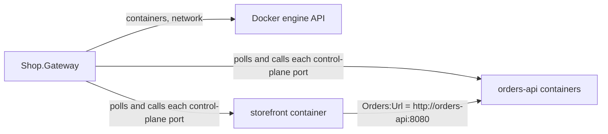

# Web on Docker

A gateway and two Web resources on the restarted Application Model ([assimalign/cohesion#1759](https://github.com/assimalign/cohesion/pull/1759)), running as containers on a Docker-compatible engine on this machine: Docker, or a Podman machine.

| Project | What it is |
| --- | --- |
| [Shop.Gateway](Shop.Gateway/Program.cs) | The gateway: declares the application and runs it on the engine with `builder.UseDocker(...)`. An `Assimalign.Cohesion.Sdk.Gateway` executable. |
| [Shop.Orders](Shop.Orders/Program.cs) | `orders-api`: a Web program that registers itself as a resource with `builder.Services.AddResource("orders-api", resource => resource.UseDocker())`. Two instances (`WithDockerReplicas(2)`). |
| [Shop.Storefront](Shop.Storefront/Program.cs) | `storefront`: a Web program whose `Orders:Url` setting is `orders-api`'s endpoint, which it calls. |



The gateway runs on the engine's host and pulls. Each resource is one container per replica on the gateway's network, `shop`, under the resource's name, so `orders-api`'s endpoint is `http://orders-api:8080` on that network. The engine publishes every container's `http` port (8080) and control-plane port (9090) on loopback ports of this machine. The gateway polls each container's control-plane port for its instance's publication and renewals, and calls its control plane there; a container needs no address of its gateway. A program serves on its `http` endpoint only after it has published.

## Packages

Everything restores from the Assimalign GitHub Packages feed, at the CI builds of the two draft pull requests:

- [`global.json`](global.json) pins the Cohesion SDKs to a CI build of cohesion's [#1759](https://github.com/assimalign/cohesion/pull/1759).
- [`Directory.Build.props`](Directory.Build.props) pins `CohesionPlatformsVersion` to a CI build of cohesion-platforms' [#35](https://github.com/assimalign/cohesion-platforms/pull/35). That build depends on exactly the cohesion build above, so the two pins move together.

A pull request's CI packages are deleted when it closes, so move both pins to `main` builds once the pull requests merge. This folder has its own `global.json`, so it is not part of the root solution.

The feed needs a token with `read:packages`, even for reads, and `gh auth login` does not grant that scope by default. Add it once, then hand the token to the root `nuget.config` through the environment:

```powershell
gh auth refresh -h github.com -s read:packages
$env:GITHUB_USERNAME = '<github-user>'
$env:GITHUB_PASSWORD = (gh auth token)
```

## Run it on Podman or Docker

Prerequisites:

- The .NET SDK `10.0.300` or later, which [`global.json`](global.json) requires.
- Podman with a running machine (`podman machine init`, then `podman machine start`), or Docker.

The gateway reaches the engine at `--endpoint`, else `DOCKER_HOST`, else the platform's default: on Windows the `docker_engine` pipe, elsewhere the Docker socket. Pass `--endpoint` in the docker CLI's form (`unix:///run/podman/podman.sock`, for example) for any other engine.

The images and the gateway must use the same engine. `publish-images.ps1` uses Podman when it is on `PATH`, else Docker; `-Engine Docker` or `-Engine Podman` picks one. A Podman machine on Windows serves the `docker_engine` pipe only when no other engine holds it, so with Docker Desktop also installed, either publish with `-Engine Docker`, or point the gateway at the Podman machine's own pipe, which `podman machine inspect --format "{{.ConnectionInfo.PodmanPipe.Path}}"` prints:

```powershell
dotnet run --project Shop.Gateway -- --endpoint npipe:////./pipe/podman-machine-default
```

From this folder:

```powershell
./publish-images.ps1               # build both programs as images for the engine's architecture and load them into its store
dotnet run --project Shop.Gateway
```

The gateway deploys `orders-api`, waits for an instance to publish, deploys `storefront` with `orders-api`'s endpoint as its setting, and prints each resource's endpoint and published instances. In `Program.cs` that is the gateway's lifecycle: `ApplicationGateway.CreateBuilder("shop")` returns an `ApplicationGatewayBuilder`, `await gateway.StartAsync()` returns once every resource has published, each `IApplicationGatewayDeployment` in `gateway.Resources` carries its outputs and instances, and `await gateway.Completion` waits until the run ends, faulting with its failure. Then, in another shell (`docker` takes the same arguments):

```powershell
podman ps --filter label=com.assimalign.cohesion.network=shop --format "{{.ID}} {{.Names}} {{.Ports}}"
curl http://127.0.0.1:<port>      # the loopback port the shop-storefront container's 8080 is published on
```

The answer names the storefront container and the `orders-api` container that served it by their host names, which are the container ids in the first column. Ctrl+C stops the gateway, and what it deployed keeps running. Running the gateway again adopts it, and replaces only a resource whose image reference, ports, replica count, or settings changed.

The image reference is the tag, `shop-orders:latest`, not the image it names, so republishing after a code change does not replace the running containers. Remove the shop before running the gateway again:

```powershell
$containers = podman ps -aq --filter label=com.assimalign.cohesion.network=shop
if ($containers) { podman rm -f $containers }
podman network rm shop
```

To remove the images as well:

```powershell
podman rmi shop-orders:latest shop-storefront:latest
```

Each Web program is also a plain application outside a gateway:

```powershell
dotnet run --project Shop.Orders
```
