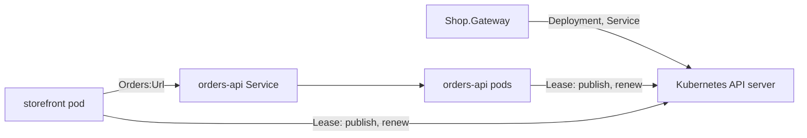

# Web on Kubernetes

A gateway and two Web resources on the restarted Application Model ([assimalign/cohesion#1759](https://github.com/assimalign/cohesion/pull/1759)), running on a Kubernetes cluster, or, with no cluster at all, inside the gateway's own process.

| Project | What it is |
| --- | --- |
| [Shop.Gateway](Shop.Gateway/Program.cs) | The gateway: declares the application and runs it on the cluster with `builder.UseKubernetes(kubernetes => ...)`, or in its own process with `builder.UseInProcess()` when it is started with `--in-process`. An `Assimalign.Cohesion.Sdk.Gateway` executable that references both programs. |
| [Shop.Orders](Shop.Orders/Program.cs) | `orders-api`: a Web program that registers itself as a resource with `builder.Services.AddResource("orders-api", resource => resource.UseKubernetes().UseInProcess())`. Two instances on the cluster. |
| [Shop.Storefront](Shop.Storefront/Program.cs) | `storefront`: a Web program whose `Orders:Url` setting is `orders-api`'s endpoint, which it calls. |

## Packages

Everything restores from the Assimalign GitHub Packages feed, at the CI builds of the two draft pull requests:

- [`global.json`](global.json) pins the Cohesion SDKs to a CI build of cohesion's [#1784](https://github.com/assimalign/cohesion/pull/1784), which stacks on [#1759](https://github.com/assimalign/cohesion/pull/1759). The in-process platform's packages, `Assimalign.Cohesion.ApplicationModel.Gateway.InProcess` and `Assimalign.Cohesion.ApplicationModel.Hosting.InProcess`, come from the same build: the projects reference them at the SDK's version, `$(CohesionVersion)`.
- [`Directory.Build.props`](Directory.Build.props) pins `CohesionPlatformsVersion` to a CI build of cohesion-platforms' [#36](https://github.com/assimalign/cohesion-platforms/pull/36), which stacks on [#35](https://github.com/assimalign/cohesion-platforms/pull/35). That build depends on exactly the cohesion build above, so the two pins move together.

A pull request's CI packages are deleted when it closes, so move both pins to `main` builds once the pull requests merge. This folder has its own `global.json`, so it is not part of the root solution, whose SDK pins serve the other examples.

The feed needs a token with `read:packages`, even for reads, and `gh auth login` does not grant that scope by default. Add it once, then hand the token to the root `nuget.config` through the environment:

```powershell
gh auth refresh -h github.com -s read:packages
$env:GITHUB_USERNAME = '<github-user>'
$env:GITHUB_PASSWORD = (gh auth token)
```

NuGet's own variable works too, and takes precedence: `$env:NuGetPackageSourceCredentials_assimalign = "Username=<github-user>;Password=$(gh auth token)"`.

## Run it in process

This needs only the .NET SDK `10.0.300` or later, which [`global.json`](global.json) requires. From this folder:

```powershell
dotnet run --project Shop.Gateway -- --in-process
```

The gateway runs both Web programs inside its own process, each on a thread of its own and a loopback port of its own. It deploys `orders-api`, waits for it to publish, deploys `storefront` with `orders-api`'s endpoint as its `Orders:Url` setting, and prints each resource's endpoint:

```text
The shop runs in this process:
  orders-api   http://127.0.0.1:56084  1 instance(s) published
  storefront   http://127.0.0.1:56085  1 instance(s) published
Try: curl http://127.0.0.1:56085
Ctrl+C stops the gateway and both programs.
```

The ports change from run to run. In another shell, request the storefront at the address the gateway printed:

```powershell
curl http://127.0.0.1:56085
```

The answer is the storefront's line, followed by what `orders-api` returned to it. Both programs run in one process, so both name this machine:

```text
storefront (<machine>) -> orders-api: {"served-by":"<machine>","orders":[{"id":1,"item":"coffee"},{"id":2,"item":"tea"}]}
```

In process, every resource runs once: `WithReplicas(2)` is the Kubernetes platform's setting, and no other platform reads it. Ctrl+C stops the gateway, and disposing it stops both programs, `storefront` first.

In `Program.cs` that is the gateway's lifecycle: `ApplicationGateway.CreateBuilder("shop")` returns an `ApplicationGatewayBuilder`, `await gateway.StartAsync()` returns once every resource has published, each `IApplicationGatewayDeployment` in `gateway.Resources` carries its outputs and instances, and `await gateway.Completion` waits until the run ends, faulting with its failure. The gateway is `await using`, so leaving the program disposes it, and with it the platform it built.

Nothing in either program changes for this. [`Shop.Gateway.csproj`](Shop.Gateway/Shop.Gateway.csproj) references the in-process platform's gateway half and both programs, and names the resource each one is:

```xml
<ProjectReference Include="..\Shop.Orders\Shop.Orders.csproj" CohesionResource="orders-api" />
<ProjectReference Include="..\Shop.Storefront\Shop.Storefront.csproj" CohesionResource="storefront" />
```

Each program references the platform's instance half and opts into it beside Kubernetes, with `resource.UseKubernetes().UseInProcess()`. The build binds each program's top-level statements to its resource, so the gateway's bare `builder.UseInProcess()` runs both. The platform is the gateway's choice when it runs: the same build runs on the cluster without `--in-process`.

## Run it on kind



The gateway runs outside the cluster and reaches it only through its API server, as the pods do. Each resource becomes a Deployment and a Service. A pod publishes its instance through a Lease, and the gateway calls its control plane through the API server's pod proxy. A pod is ready once its program listens on its `http` endpoint, which happens only after it has published.

Prerequisites:

- The .NET SDK `10.0.300` or later, which [`global.json`](global.json) requires.
- Podman with a rootful machine. kind's nodes need cgroup and netfilter features a rootless machine does not have. To switch an existing machine: `podman machine stop`, `podman machine set --rootful`, `podman machine start`. Docker works too: pass `-Engine docker` to the cluster script and `-Engine Docker` to `publish-images.ps1`.
- [kind](https://kind.sigs.k8s.io/) and [kubectl](https://kubernetes.io/docs/tasks/tools/).
- A cluster named `cohesion` with a local registry at `localhost:5001`. The cluster script in [cohesion-platforms](https://github.com/assimalign/cohesion-platforms) creates both; clone it beside this repository and run `platforms/Kubernetes/scripts/New-CohesionKindCluster.ps1` from it. kubectl then has the context `kind-cohesion`.

From this folder:

```powershell
./publish-images.ps1                                    # build both programs as images for the cluster's architecture and push them
dotnet run --project Shop.Gateway -- --context kind-cohesion
```

`builder.UseKubernetes(kubernetes => ...)` sets the cluster's options on `kubernetes.Options` (the context, the namespace `shop`, the image pull policy) and binds each resource to its image with `kubernetes.AddImage(...)`. The gateway builds that infrastructure when it is built, and disposing the gateway disposes it, which ends the gateway's connection to the cluster and leaves what it deployed running.

The gateway deploys `orders-api`, waits for an instance to publish, deploys `storefront` with `orders-api`'s endpoint as its setting, and prints each resource's endpoint. Then, in another shell:

```powershell
kubectl --context kind-cohesion --namespace shop port-forward service/storefront 8080:80
curl http://localhost:8080
```

The answer names the storefront pod and one of the two `orders-api` pods that served it. Ctrl+C stops the gateway, and what it deployed keeps running. Running the gateway again adopts it, and updates only a resource whose image reference, ports, replica count, or settings changed.

The image reference is the tag, `localhost:5001/shop-orders:latest`, not the image it names, so republishing after a code change leaves the running pods on the old image. Restart them, and their new pods pull the new push:

```powershell
kubectl --context kind-cohesion --namespace shop rollout restart deployment
```

`kubectl --context kind-cohesion delete namespace shop` removes the shop.

## Each program on its own

Each Web program is also a plain application outside a gateway:

```powershell
dotnet run --project Shop.Orders
```
